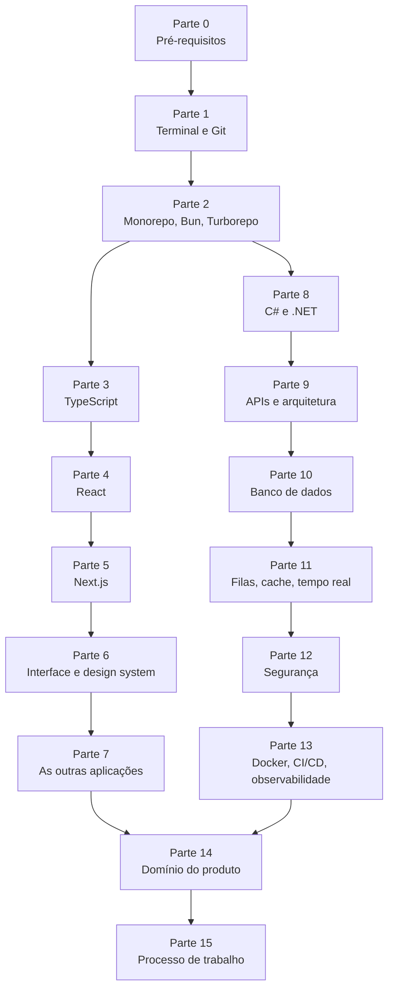

# Roadmap Novus CRM

Roteiro de estudo para desenvolvedor iniciante que vai trabalhar na plataforma
Novus CRM. No formato do [roadmap.sh](https://roadmap.sh): uma árvore de
tópicos, cada um com explicação, contexto de uso e referências com
documentação oficial e vídeos.

**Este guia é independente.** Você não precisa abrir o código do projeto para
estudar. Tudo que o projeto usa está explicado aqui, em texto.

## Os três documentos desta pasta

| Arquivo | O que é | Quando usar |
|---|---|---|
| **README.md** | Este roteiro. 126 tópicos em ordem de estudo, com referências e vídeos. | Para estudar por trilha, do começo ao fim. |
| **[dicionario-de-termos.md](dicionario-de-termos.md)** | Dicionário de jargão. Tradução literal, a armadilha de cada termo, o que ele é de verdade, analogia e o trade-off. | Quando alguém falar uma palavra que você não conhece. |
| **[mapa-novus-crm.md](mapa-novus-crm.md)** | Versão curta, focada na estrutura do repositório do produto. | Para se localizar no código, quando tiver acesso a ele. |

O [Apêndice A](#apêndice-a-glossário) deste roteiro tem um glossário de consulta
rápida com cerca de 200 termos. O dicionário é a versão longa e explicada dos
mesmos termos, com o porquê de cada um.

---

## Como usar

Cada tópico tem a mesma estrutura:

- **O que é**: a explicação do conceito, do zero.
- **No Novus CRM**: como o conceito aparece na plataforma, descrito em texto.
- **Referências**: onde estudar.

Marcadores dos links:

| Marca | Significa |
|---|---|
| 📘 | Documentação oficial |
| 📄 | Artigo ou livro gratuito |
| 🎥 | Canal, playlist ou curso em vídeo |
| 🔎 | Busca pronta no YouTube |
| 🧪 | Exercício prático |

Sobre os links 🔎: são buscas no YouTube com a frase exata já preenchida. Foi
escolha consciente. Vídeo individual sai do ar e fica desatualizado, a busca
sempre devolve o conteúdo mais recente e com mais audiência sobre o tema.

Marcação de prioridade em cada tópico:

- `essencial` você não consegue trabalhar sem isso.
- `importante` vai aparecer no primeiro mês.
- `aprofundar` deixe para o segundo ou terceiro mês.
- `contexto` leitura de uma vez, só para entender de onde vem.

---

## O mapa



Se o diagrama acima aparecer como texto, seu visualizador não desenha Mermaid.
O índice abaixo tem a mesma informação.

---

## Índice

**[Parte 0. Pré-requisitos](#parte-0-pré-requisitos)**
[0.1](#01-lógica-de-programação) Lógica ·
[0.2](#02-html-e-css) HTML e CSS ·
[0.3](#03-javascript-moderno) JavaScript ·
[0.4](#04-o-que-é-uma-aplicação-web) Aplicação web

**[Parte 1. Terminal e Git](#parte-1-terminal-e-git)**
[1.1](#11-linha-de-comando) Linha de comando ·
[1.2](#12-git-o-modelo-mental) Git, modelo mental ·
[1.3](#13-git-no-dia-a-dia) Git no dia a dia ·
[1.4](#14-branch-merge-e-conflito) Branch e conflito ·
[1.5](#15-pull-request-e-code-review) Pull Request ·
[1.6](#16-conventional-commits) Conventional Commits ·
[1.7](#17-editor-e-ferramentas) Editor

**[Parte 2. Monorepo e ferramentas JavaScript](#parte-2-monorepo-e-ferramentas-javascript)**
[2.1](#21-node-e-o-runtime-javascript) Node ·
[2.2](#22-bun) Bun ·
[2.3](#23-packagejson-e-dependências) package.json ·
[2.4](#24-lockfile-e-versionamento-semântico) Lockfile e SemVer ·
[2.5](#25-monorepo-e-workspaces) Monorepo ·
[2.6](#26-turborepo-e-cache-de-build) Turborepo ·
[2.7](#27-biome-lint-e-formatação) Biome

**[Parte 3. TypeScript](#parte-3-typescript)**
[3.1](#31-tipagem-estática-e-o-modo-strict) Tipagem estática ·
[3.2](#32-união-literal-e-união-discriminada) Uniões ·
[3.3](#33-genéricos) Genéricos ·
[3.4](#34-unknown-never-e-type-guards) unknown e guards ·
[3.5](#35-utility-types) Utility types ·
[3.6](#36-zod-e-validação-em-tempo-de-execução) Zod ·
[3.7](#37-tipagem-de-borda-dto-e-view) DTO e View

**[Parte 4. React](#parte-4-react)**
[4.1](#41-componente-e-jsx) Componente e JSX ·
[4.2](#42-props-e-estado) Props e estado ·
[4.3](#43-hooks-essenciais) Hooks ·
[4.4](#44-listas-chaves-e-eventos) Listas e eventos ·
[4.5](#45-composição-em-vez-de-herança) Composição ·
[4.6](#46-context-e-estado-compartilhado) Context ·
[4.7](#47-do-angular-para-o-react) Do Angular para o React

**[Parte 5. Next.js](#parte-5-nextjs)**
[5.1](#51-csr-ssr-ssg-e-isr) Modos de renderização ·
[5.2](#52-app-router) App Router ·
[5.3](#53-server-components-e-client-components) Server Components ·
[5.4](#54-server-actions) Server Actions ·
[5.5](#55-layout-loading-error-e-not-found) Arquivos especiais ·
[5.6](#56-route-groups-e-rotas-dinâmicas) Route groups ·
[5.7](#57-proteção-de-rota-middleware-e-proxy) Proteção de rota ·
[5.8](#58-cache-e-revalidação) Cache ·
[5.9](#59-build-standalone-e-variáveis-de-ambiente) Build e env

**[Parte 6. Interface e design system](#parte-6-interface-e-design-system)**
[6.1](#61-tailwind-css) Tailwind ·
[6.2](#62-tokens-e-temas) Tokens ·
[6.3](#63-design-system-e-primitives) Design system ·
[6.4](#64-radix-e-componentes-acessíveis) Radix ·
[6.5](#65-formulários-com-react-hook-form) Formulários ·
[6.6](#66-tabelas-virtualização-e-rolagem-infinita) Tabelas ·
[6.7](#67-editores-gráficos-e-arrastar-e-soltar) Editores e gráficos ·
[6.8](#68-acessibilidade) Acessibilidade

**[Parte 7. As outras aplicações](#parte-7-as-outras-aplicações)**
[7.1](#71-spa-com-vite) SPA com Vite ·
[7.2](#72-tanstack-router-e-query) TanStack ·
[7.3](#73-site-estático-e-seo) Site estático ·
[7.4](#74-widget-em-iframe) Widget em iframe ·
[7.5](#75-react-native-e-expo) React Native

**[Parte 8. C# e .NET](#parte-8-c-e-net)**
[8.1](#81-como-o-c-roda) Como o C# roda ·
[8.2](#82-tipos-classes-e-objetos) Classes e objetos ·
[8.3](#83-propriedades-métodos-e-construtores) Propriedades e métodos ·
[8.4](#84-interface-herança-e-polimorfismo) Interface e herança ·
[8.5](#85-nulo-e-tratamento-de-erro) Nulo e erro ·
[8.6](#86-coleções-e-linq) Coleções e LINQ ·
[8.7](#87-async-await-e-task) async e await ·
[8.8](#88-injeção-de-dependência) Injeção de dependência ·
[8.9](#89-configuração-e-segredos) Configuração ·
[8.10](#810-logging) Logging

**[Parte 9. APIs e arquitetura de backend](#parte-9-apis-e-arquitetura-de-backend)**
[9.1](#91-http-por-dentro) HTTP ·
[9.2](#92-rest-e-desenho-de-api) REST ·
[9.3](#93-aspnet-core-e-controllers) ASP.NET Core ·
[9.4](#94-dto-e-mapeamento) DTO ·
[9.5](#95-arquitetura-em-camadas-e-ddd) Camadas e DDD ·
[9.6](#96-repository-e-unit-of-work) Repository ·
[9.7](#97-cqrs-e-mediator) CQRS ·
[9.8](#98-openapi-e-swagger) OpenAPI ·
[9.9](#99-validação-e-mensagens-de-erro) Validação ·
[9.10](#910-testes-automatizados) Testes

**[Parte 10. Banco de dados](#parte-10-banco-de-dados)**
[10.1](#101-modelo-relacional) Modelo relacional ·
[10.2](#102-sql-essencial) SQL ·
[10.3](#103-índices-e-desempenho) Índices ·
[10.4](#104-transações) Transações ·
[10.5](#105-postgresql) PostgreSQL ·
[10.6](#106-orm-e-entity-framework-core) EF Core ·
[10.7](#107-migrations) Migrations ·
[10.8](#108-modelo-compilado) Modelo compilado ·
[10.9](#109-multi-tenant) Multi-tenant ·
[10.10](#1010-modelagem-e-dados-pessoais) Dados pessoais

**[Parte 11. Filas, cache e tempo real](#parte-11-filas-cache-e-tempo-real)**
[11.1](#111-por-que-existe-trabalho-em-segundo-plano) Trabalho de fundo ·
[11.2](#112-worker-e-hosted-service) Worker ·
[11.3](#113-filas-e-rabbitmq) RabbitMQ ·
[11.4](#114-padrões-de-mensageria) Padrões de mensageria ·
[11.5](#115-cache-e-redis) Redis ·
[11.6](#116-tempo-real-websocket-e-signalr) SignalR ·
[11.7](#117-webhooks) Webhooks ·
[11.8](#118-agendamento-e-tarefas-periódicas) Agendamento

**[Parte 12. Segurança](#parte-12-segurança)**
[12.1](#121-autenticação-e-autorização) AuthN e AuthZ ·
[12.2](#122-oauth-2-e-openid-connect) OAuth e OIDC ·
[12.3](#123-jwt) JWT ·
[12.4](#124-keycloak) Keycloak ·
[12.5](#125-sessão-cookies-e-csrf) Cookies e CSRF ·
[12.6](#126-cors) CORS ·
[12.7](#127-xss-e-content-security-policy) XSS e CSP ·
[12.8](#128-injeção-de-sql-e-validação-de-entrada) SQL injection ·
[12.9](#129-segredos) Segredos ·
[12.10](#1210-owasp-top-10) OWASP Top 10

**[Parte 13. Entrega e operação](#parte-13-entrega-e-operação)**
[13.1](#131-docker) Docker ·
[13.2](#132-dockerfile-e-camadas) Dockerfile ·
[13.3](#133-net-aspire) Aspire ·
[13.4](#134-kubernetes-em-linhas-gerais) Kubernetes ·
[13.5](#135-nginx) nginx ·
[13.6](#136-cicd-e-azure-pipelines) CI/CD ·
[13.7](#137-ambientes-e-estratégia-de-deploy) Ambientes ·
[13.8](#138-observabilidade) Observabilidade ·
[13.9](#139-opentelemetry-e-prometheus) OpenTelemetry

**[Parte 14. O domínio do produto](#parte-14-o-domínio-do-produto)**
[14.1](#141-o-que-é-um-crm-de-atendimento) O que é o produto ·
[14.2](#142-vocabulário-da-plataforma) Vocabulário ·
[14.3](#143-canais-de-mensagem) Canais ·
[14.4](#144-telefonia-sip-pbx-e-webrtc) Telefonia ·
[14.5](#145-ia-aplicada-llm-embeddings-e-rag) IA aplicada ·
[14.6](#146-planos-assinatura-e-cobrança) Assinatura

**[Parte 15. Processo de trabalho](#parte-15-processo-de-trabalho)**
[15.1](#151-desenvolvimento-guiado-por-especificação) Spec-driven ·
[15.2](#152-code-review-na-prática) Code review ·
[15.3](#153-escrita-técnica-e-texto-de-interface) Escrita ·
[15.4](#154-trabalhar-com-agentes-de-ia) Agentes de IA ·
[15.5](#155-método-de-depuração) Depuração

**[Apêndices](#apêndices)**
[A](#apêndice-a-glossário) Glossário ·
[B](#apêndice-b-plano-de-12-semanas) Plano de 12 semanas ·
[C](#apêndice-c-checklist-de-competências) Checklist ·
[D](#apêndice-d-links-mestres) Links mestres

---

## Parte 0. Pré-requisitos

Se você já trabalha com Angular, esta parte inteira está feita. Ela existe para
você conferir se não ficou buraco.

### 0.1 Lógica de programação

`essencial` · você já tem

**O que é**

A base de tudo. Variável guarda um valor. Condição escolhe um caminho. Laço
repete. Função agrupa um pedaço de trabalho com nome. Estrutura de dados
organiza vários valores juntos, como lista e objeto.

Quem pula essa base trava mais tarde em coisas que parecem de framework, mas
são de lógica. Um exemplo comum é não conseguir transformar uma lista de um
formato em outro.

**No Novus CRM**

Transformar lista aparece todo dia. A API devolve uma lista de registros num
formato e a tela precisa de outro. Esse trabalho de converter tem nome no
projeto, chama-se mapper.

**Referências**

- 📄 [Curso em Vídeo, Algoritmos](https://www.cursoemvideo.com/curso/curso-de-algoritmo/)
- 🎥 [Canal Curso em Vídeo](https://www.youtube.com/@CursoemVideo)
- 🔎 [Busca: lógica de programação do zero](https://www.youtube.com/results?search_query=l%C3%B3gica+de+programa%C3%A7%C3%A3o+do+zero)

### 0.2 HTML e CSS

`essencial` · você já tem

**O que é**

HTML é a estrutura da página, as caixas e os textos. CSS é a aparência, as
cores, tamanhos e posições. Vale revisar dois pontos que o Angular costuma
esconder: o modelo de caixa, que explica por que um elemento ocupa mais espaço
do que você mandou, e flexbox e grid, que são as duas formas modernas de
posicionar coisas.

**No Novus CRM**

As telas usam Tailwind, que é CSS escrito em classes curtas. Sem entender
flexbox, as classes do Tailwind viram tentativa e erro.

**Referências**

- 📘 [MDN, aprender HTML](https://developer.mozilla.org/pt-BR/docs/Learn/HTML)
- 📘 [MDN, aprender CSS](https://developer.mozilla.org/pt-BR/docs/Learn/CSS)
- 📄 [Flexbox Froggy, jogo para treinar flexbox](https://flexboxfroggy.com/#pt-br)
- 📄 [Grid Garden, jogo para treinar grid](https://cssgridgarden.com/#pt-br)
- 🔎 [Busca: flexbox e grid na prática](https://www.youtube.com/results?search_query=flexbox+e+grid+css+na+pr%C3%A1tica)

### 0.3 JavaScript moderno

`essencial` · você já tem

**O que é**

A linguagem que roda no navegador. O que mais importa aqui: funções de seta,
desestruturação, espalhamento, módulos com import e export, promessas com
`async` e `await`, e os métodos de array `map`, `filter`, `reduce` e `find`.

**No Novus CRM**

Todo o frontend é JavaScript tipado. Os métodos de array substituem o que no
Angular você faria com pipes e operadores do RxJS.

**Referências**

- 📘 [MDN, guia de JavaScript](https://developer.mozilla.org/pt-BR/docs/Web/JavaScript/Guide)
- 📄 [javascript.info, em inglês, o melhor material gratuito](https://javascript.info/)
- 🎥 [Canal Rocketseat](https://www.youtube.com/@rocketseat)
- 🔎 [Busca: JavaScript ES6 map filter reduce](https://www.youtube.com/results?search_query=javascript+map+filter+reduce+explicado)

### 0.4 O que é uma aplicação web

`essencial` · 1h

**O que é**

Uma aplicação web tem pelo menos duas metades. O **cliente** é o que roda na
máquina do usuário, no navegador. O **servidor** é o que roda na máquina da
empresa e guarda os dados. Entre os dois existe a rede, e a conversa acontece
por HTTP.

O navegador pede uma página, o servidor responde. Depois a página pede dados,
em geral em formato JSON, e desenha a tela com eles. Quando uma aplicação é
lenta ou quebra, o primeiro passo do diagnóstico é descobrir em qual das
metades o problema está.

**No Novus CRM**

Existem três metades, não duas. O navegador fala com o servidor das telas, que
é feito em Next.js. Esse servidor fala com a API, que é feita em .NET. O
navegador nunca fala com a API direto. Essa escolha mantém o token de acesso
longe do navegador.

**Referências**

- 📘 [MDN, como a web funciona](https://developer.mozilla.org/pt-BR/docs/Learn/Getting_started_with_the_web/How_the_Web_works)
- 📄 [Cloudflare, o que é uma API](https://www.cloudflare.com/pt-br/learning/security/api/what-is-an-api/)
- 🔎 [Busca: como funciona cliente e servidor](https://www.youtube.com/results?search_query=como+funciona+cliente+e+servidor+web)

---

## Parte 1. Terminal e Git

### 1.1 Linha de comando

`essencial` · 3h

**O que é**

O terminal é a forma de dar ordem ao computador escrevendo, em vez de clicando.
Parece retrocesso e não é. Comando escrito pode ser repetido, guardado,
combinado com outro e colocado numa esteira automática.

O mínimo que você precisa: andar entre pastas com `cd`, listar com `ls`, ver o
conteúdo de um arquivo com `cat`, procurar texto dentro dos arquivos com `grep`
e encadear comandos com o caractere de barra vertical.

No Windows existem três terminais diferentes e eles não são iguais. O PowerShell
é o padrão do sistema. O Git Bash vem com o Git e usa comandos no estilo Linux.
O WSL roda um Linux de verdade por dentro. Saber qual você está usando evita uma
hora de confusão com um comando que "não existe".

**No Novus CRM**

Todo comando de trabalho é digitado. Subir uma aplicação, rodar teste, gerar
migração de banco, construir imagem. A documentação do projeto assume terminal.

**Referências**

- 📄 [Guia de linha de comando da MDN](https://developer.mozilla.org/pt-BR/docs/Learn/Tools_and_testing/Understanding_client-side_tools/Command_line)
- 📘 [Documentação do PowerShell](https://learn.microsoft.com/pt-br/powershell/)
- 📘 [WSL, Linux dentro do Windows](https://learn.microsoft.com/pt-br/windows/wsl/)
- 🔎 [Busca: terminal Linux para iniciantes](https://www.youtube.com/results?search_query=terminal+linux+para+iniciantes+comandos+b%C3%A1sicos)
- 🧪 Ache todos os arquivos de uma pasta que contenham a palavra `token`, usando só o terminal.

### 1.2 Git, o modelo mental

`essencial` · 4h

**O que é**

Git guarda o histórico do código. A parte difícil não são os comandos, é o
modelo mental. Existem quatro lugares onde o seu código pode estar:

1. **Diretório de trabalho**: o arquivo como está na sua tela agora.
2. **Área de stage**: o que você escolheu para entrar no próximo commit.
3. **Repositório local**: os commits já gravados na sua máquina.
4. **Repositório remoto**: o servidor que o time compartilha.

Quase todo comando do Git move algo de um desses lugares para outro. `add` vai
do trabalho para o stage. `commit` vai do stage para o local. `push` vai do
local para o remoto. `pull` traz do remoto.

Um **commit** é uma foto completa do projeto num instante, com autor, data e
mensagem. Ele não guarda só a diferença, apesar de o Git mostrar diferença na
hora de ler.

**No Novus CRM**

O repositório é um só e guarda backend, telas e documentação juntos. O histórico
de uma das aplicações é antigo e foi preservado numa migração de repositório, o
que significa que o `git log` enxerga commits de antes da junção.

**Referências**

- 📄 [Pro Git, o livro oficial, em português](https://git-scm.com/book/pt-br/v2)
- 📘 [Documentação do Git](https://git-scm.com/doc)
- 📄 [Learn Git Branching, visual e interativo](https://learngitbranching.js.org/?locale=pt_BR)
- 🎥 [Canal GitHub](https://www.youtube.com/@GitHub)
- 🔎 [Busca: curso de Git e GitHub completo](https://www.youtube.com/results?search_query=curso+de+git+e+github+completo+iniciante)

### 1.3 Git no dia a dia

`essencial` · 3h

**O que é**

A rotina real é menor do que parece. Ver o estado com `git status`. Ver o que
mudou com `git diff`. Selecionar com `git add`. Gravar com `git commit`. Trazer
o que o time fez com `git pull`. Enviar o seu com `git push`.

Três comandos de resgate que você vai usar cedo:

- `git restore <arquivo>` descarta a alteração de um arquivo.
- `git reset --soft HEAD~1` desfaz o último commit e mantém o conteúdo.
- `git stash` guarda o trabalho pela metade numa gaveta e limpa a mesa.

**No Novus CRM**

A regra é não fazer commit nem push sem pedido. Trabalho em andamento fica no
seu branch e entra na linha principal por Pull Request.

**Referências**

- 📘 [Referência de comandos do Git](https://git-scm.com/docs)
- 📄 [Atlassian, tutoriais de Git em português](https://www.atlassian.com/br/git/tutorials)
- 📄 [Oh Shit, Git. Como sair de enrascadas](https://ohshitgit.com/pt_br)
- 🔎 [Busca: git desfazer commit e alterações](https://www.youtube.com/results?search_query=git+como+desfazer+commit+e+altera%C3%A7%C3%B5es)

### 1.4 Branch, merge e conflito

`essencial` · 4h

**O que é**

Um **branch** é uma linha de trabalho paralela. Você sai da linha principal,
trabalha isolado e depois junta. Isso permite que várias pessoas mexam no mesmo
projeto sem atropelar umas às outras.

Juntar tem duas formas. O **merge** cria um commit de encontro e preserva o
desenho real do que aconteceu. O **rebase** reescreve os seus commits como se
você tivesse começado depois, o que deixa o histórico em linha reta.

**Conflito** acontece quando duas pessoas mudam a mesma região do mesmo arquivo.
O Git não escolhe por você. Ele marca o trecho e espera a decisão humana. Não é
erro, é a ferramenta pedindo ajuda.

**No Novus CRM**

O nome do branch começa com o número do cartão de tarefa, seguido de uma
descrição curta com hífens. A linha principal se chama `master` e é o que está
em produção.

**Referências**

- 📄 [Pro Git, capítulo 3, ramificação](https://git-scm.com/book/pt-br/v2/Ramifica%C3%A7%C3%A3o-Branching-no-Git-Ramifica%C3%A7%C3%B5es-em-poucas-palavras)
- 📄 [Atlassian, merge contra rebase](https://www.atlassian.com/br/git/tutorials/merging-vs-rebasing)
- 📄 [Learn Git Branching, exercícios de branch](https://learngitbranching.js.org/?locale=pt_BR)
- 🔎 [Busca: resolver conflito de merge no git](https://www.youtube.com/results?search_query=resolver+conflito+de+merge+git)

### 1.5 Pull Request e code review

`importante` · 2h

**O que é**

O Pull Request é o pedido formal de juntar o seu branch na linha principal. Ele
existe por dois motivos. Primeiro, dá um lugar para outra pessoa ler o código
antes de entrar. Segundo, cria registro do porquê daquela mudança.

Um bom Pull Request explica o problema, o que mudou, o que foi testado e o que
pode quebrar. A descrição é lida por gente que não acompanhou a conversa.

Receber revisão é parte do trabalho e não é crítica pessoal. Comentar o código
de outra pessoa também é habilidade. A pergunta costuma funcionar melhor que a
afirmação.

**No Novus CRM**

O repositório fica no Azure DevOps, não no GitHub. A mecânica é a mesma. O
cartão de tarefa é vinculado ao Pull Request pelo número dele.

**Referências**

- 📘 [Azure DevOps, Pull Requests](https://learn.microsoft.com/pt-br/azure/devops/repos/git/pull-requests)
- 📄 [Google, guia de code review](https://google.github.io/eng-practices/review/)
- 📄 [Conventional Comments, como comentar revisão](https://conventionalcomments.org/)
- 🔎 [Busca: como fazer code review](https://www.youtube.com/results?search_query=como+fazer+code+review+boas+pr%C3%A1ticas)

### 1.6 Conventional Commits

`importante` · 1h

**O que é**

É um padrão de escrita para a mensagem de commit. A forma é
`tipo(escopo): descrição`. O tipo diz a natureza da mudança. O escopo diz onde
ela aconteceu. A descrição diz o que ela faz, no imperativo.

Os tipos mais usados são `feat` para funcionalidade nova, `fix` para correção,
`refactor` para mudança interna sem efeito visível, `docs` para documentação,
`test` para teste, `chore` para tarefa de manutenção, `perf` para desempenho,
`ci` e `build` para esteira e empacotamento.

O ganho não é estético. Com padrão, dá para gerar changelog automático, filtrar
histórico por tipo e entender uma lista de 50 commits em um minuto.

**No Novus CRM**

A mensagem é escrita em português, em minúscula, sem ponto final. O escopo é a
área tocada, como `admin`, `backend` ou `monorepo`. Um exemplo real do
repositório é `fix(backend): corrigir cálculo de SLA`.

**Referências**

- 📘 [Conventional Commits, em português](https://www.conventionalcommits.org/pt-br/v1.0.0/)
- 📄 [Como escrever uma boa mensagem de commit](https://cbea.ms/git-commit/)
- 🔎 [Busca: conventional commits explicado](https://www.youtube.com/results?search_query=conventional+commits+explicado+portugu%C3%AAs)

### 1.7 Editor e ferramentas

`importante` · 2h

**O que é**

O editor usado no projeto é o Visual Studio Code. Ele serve para as duas
stacks. Para o backend em C# também existe o Visual Studio completo, que alguns
preferem por causa do depurador e das ferramentas de banco.

O que vale configurar logo: formatação ao salvar, busca em todos os arquivos,
ir para a definição de um símbolo com F12, e o depurador com pontos de parada.
Aprender a depurar passo a passo economiza mais tempo do que qualquer atalho.

**No Novus CRM**

A formatação do código TypeScript é feita por uma ferramenta própria do projeto
e roda por comando. Não dependa só do editor.

**Referências**

- 📘 [Documentação do VS Code](https://code.visualstudio.com/docs)
- 📘 [C# no VS Code](https://code.visualstudio.com/docs/languages/csharp)
- 📘 [Depuração no VS Code](https://code.visualstudio.com/docs/editor/debugging)
- 🎥 [Canal Visual Studio Code](https://www.youtube.com/@code)
- 🔎 [Busca: VS Code dicas e atalhos](https://www.youtube.com/results?search_query=vs+code+dicas+e+atalhos+produtividade)

---

## Parte 2. Monorepo e ferramentas JavaScript

### 2.1 Node e o runtime JavaScript

`essencial` · 2h

**O que é**

JavaScript nasceu no navegador. O Node é o programa que faz JavaScript rodar
fora dele, no servidor ou na sua máquina. Foi o Node que permitiu usar a mesma
linguagem nas duas pontas.

Dois conceitos do Node aparecem o tempo todo. O **event loop** explica como uma
linguagem de uma thread só consegue atender muitas coisas ao mesmo tempo, sem
travar. E **npm**, o registro público de onde vêm os pacotes de terceiros.

**No Novus CRM**

O projeto não usa o Node para rodar comando, usa o Bun. Mas o ecossistema é o
mesmo e, em produção, as aplicações Next ainda rodam sobre Node.

**Referências**

- 📘 [Documentação do Node.js](https://nodejs.org/pt/docs)
- 📄 [Explicação visual do event loop](https://nodejs.org/en/learn/asynchronous-work/event-loop-timers-and-nexttick)
- 🔎 [Busca: event loop JavaScript explicado](https://www.youtube.com/results?search_query=event+loop+javascript+explicado)

### 2.2 Bun

`essencial` · 2h

**O que é**

Bun é um substituto do Node e do npm ao mesmo tempo. Ele roda JavaScript e
TypeScript, instala dependências, executa scripts e roda testes. O motivo de
existir é velocidade. Instalar dependências com ele costuma levar uma fração do
tempo.

Os comandos equivalem ao que você já conhece. `bun install` instala.
`bun run <script>` executa um script. `bunx` roda uma ferramenta sem instalar,
como o `npx`.

**No Novus CRM**

Bun é o único gerenciador permitido. Usar `npm`, `npx`, `yarn` ou `pnpm` está
proibido por escrito no guia do repositório. O motivo é concreto: cada
gerenciador escreve um arquivo de trava próprio, e dois arquivos de trava no
mesmo projeto fazem a esteira de build falhar para todo mundo.

Outra regra: `bun install` roda só na raiz do repositório. Rodar dentro de uma
aplicação cria uma segunda instalação isolada e quebra o compartilhamento de
código entre as pastas.

**Referências**

- 📘 [Documentação do Bun](https://bun.sh/docs)
- 📘 [Bun, gerenciador de pacotes](https://bun.sh/docs/cli/install)
- 🎥 [Canal Oven, criadores do Bun](https://www.youtube.com/@bunjavascript)
- 🔎 [Busca: Bun JavaScript runtime o que é](https://www.youtube.com/results?search_query=bun+javascript+runtime+o+que+%C3%A9)

### 2.3 package.json e dependências

`essencial` · 2h

**O que é**

O `package.json` é a identidade de um projeto JavaScript. Ele guarda o nome, a
versão, a lista de dependências e os scripts.

**Dependência** é código de terceiros que o seu projeto usa em produção.
**Dependência de desenvolvimento** é o que só serve enquanto você trabalha,
como ferramenta de teste ou de formatação. A diferença importa porque o pacote
final não precisa carregar a segunda lista.

**Script** é um atalho de comando. Quando você vê `bun run dev`, existe uma
linha no `package.json` dizendo o que `dev` significa naquele projeto.

**No Novus CRM**

Existe um `package.json` na raiz, com os atalhos gerais, e um em cada aplicação
e pacote. Os atalhos da raiz são os que o time usa no dia a dia, como subir uma
aplicação específica em modo de desenvolvimento.

**Referências**

- 📘 [npm, referência do package.json](https://docs.npmjs.com/cli/configuring-npm/package-json)
- 📘 [Bun, scripts e workspaces](https://bun.sh/docs/cli/run)
- 🔎 [Busca: package.json explicado](https://www.youtube.com/results?search_query=package.json+explicado+dependencias+scripts)

### 2.4 Lockfile e versionamento semântico

`importante` · 2h

**O que é**

**Versionamento semântico** é o padrão de três números numa versão, como
`2.10.3`. O primeiro é maior e muda quando algo quebra compatibilidade. O do
meio é menor e muda quando entra novidade compatível. O último é correção.

No `package.json` a versão costuma vir com um acento circunflexo, como
`^2.10.3`. Isso significa "qualquer versão compatível a partir desta". É ótimo
para receber correção e péssimo para reprodutibilidade, porque dois
desenvolvedores podem acabar com versões diferentes.

O **lockfile** resolve isso. Ele anota a versão exata de cada dependência, e de
cada dependência das dependências. Com ele, todo mundo instala exatamente a
mesma árvore, inclusive a máquina que monta a imagem de produção.

**No Novus CRM**

O lockfile é único e fica na raiz. A esteira de build instala com a opção que
proíbe recalcular o arquivo. Se faltar algum manifesto na hora de montar a
imagem, o build falha com uma mensagem sobre mudanças no lockfile.

**Referências**

- 📘 [Versionamento semântico, em português](https://semver.org/lang/pt-BR/)
- 📄 [Por que o lockfile importa](https://docs.npmjs.com/cli/configuring-npm/package-lock-json)
- 🔎 [Busca: versionamento semântico semver](https://www.youtube.com/results?search_query=versionamento+sem%C3%A2ntico+semver+explicado)

### 2.5 Monorepo e workspaces

`essencial` · 3h

**O que é**

Monorepo é a decisão de guardar vários projetos num repositório só. A
alternativa, um repositório por projeto, se chama polyrepo.

A vantagem do monorepo é mudar várias partes na mesma alteração. Se a API ganha
um campo novo e a tela precisa mostrar esse campo, as duas mudanças entram
juntas, são revisadas juntas e sobem juntas. Em repositórios separados isso vira
coordenação manual.

A desvantagem é tamanho e acoplamento. Fica mais fácil misturar convenções que
deveriam ser separadas, e o repositório inteiro fica grande.

**Workspace** é o mecanismo que faz o monorepo funcionar na prática em
JavaScript. Você declara quais pastas são projetos e o gerenciador instala tudo
de uma vez, numa pasta compartilhada. Um projeto consegue importar o outro pelo
nome, como se fosse pacote publicado, sem publicar nada.

**No Novus CRM**

O repositório junta um backend em .NET, oito aplicações de interface e um
conjunto de pacotes compartilhados. As duas stacks convivem, mas têm cadeias de
ferramentas separadas. Não existe um comando único que construa tudo.

As aplicações de interface são: a web que os clientes usam, um painel interno,
um site de marketing, uma página de status, um widget de chat para colar em site
de terceiro, um aplicativo mobile, a documentação pública e um serviço de borda
para plugins.

**Referências**

- 📘 [Monorepos, por Turborepo](https://turborepo.com/docs/crafting-your-repository/structuring-a-repository)
- 📄 [monorepo.tools, panorama do assunto](https://monorepo.tools/)
- 📘 [Workspaces no Bun](https://bun.sh/docs/install/workspaces)
- 🔎 [Busca: monorepo o que é vantagens](https://www.youtube.com/results?search_query=monorepo+o+que+%C3%A9+vantagens+e+desvantagens)

### 2.6 Turborepo e cache de build

`importante` · 2h

**O que é**

Turborepo é o orquestrador de tarefas de um monorepo. Ele resolve dois
problemas.

O primeiro é ordem. Se a aplicação depende de um pacote interno, o pacote
precisa ser construído antes. Você declara a dependência uma vez e a ferramenta
descobre a ordem sozinha.

O segundo é repetição. Se nada mudou num projeto, construir de novo é
desperdício. O Turborepo guarda o resultado anterior junto com uma impressão
digital das entradas. Se a impressão bate, ele devolve o resultado guardado em
vez de refazer o trabalho.

Para isso funcionar, cada tarefa precisa declarar o que produz. Se um arquivo de
saída ficar fora da lista, o cache passa a mentir, devolvendo resultado
incompleto.

**No Novus CRM**

O backend em .NET fica fora do Turborepo, de propósito. Ele tem a própria cadeia
de ferramentas. Um segundo build sem mudanças nas telas deve terminar na hora,
com uma mensagem indicando que tudo veio do cache.

**Referências**

- 📘 [Documentação do Turborepo](https://turborepo.com/docs)
- 📘 [Como o cache funciona](https://turborepo.com/docs/crafting-your-repository/caching)
- 🎥 [Canal Vercel](https://www.youtube.com/@VercelHQ)
- 🔎 [Busca: turborepo tutorial](https://www.youtube.com/results?search_query=turborepo+tutorial+monorepo)

### 2.7 Biome, lint e formatação

`importante` · 1h

**O que é**

Duas tarefas diferentes que costumam andar juntas. **Formatação** cuida da
aparência do código, como aspas, vírgulas e quebra de linha. **Lint** procura
problema real, como variável não usada, comparação suspeita ou uso de recurso
proibido pelo time.

Historicamente eram duas ferramentas, Prettier e ESLint. Biome faz as duas,
muito mais rápido, com um arquivo de configuração só.

A ideia por trás é tirar a discussão de estilo da revisão de código. Se a
máquina formata, ninguém gasta comentário com vírgula.

**No Novus CRM**

A configuração é compartilhada entre as aplicações e barra algumas coisas de
propósito: o tipo `any`, o `enum` do TypeScript, exportação padrão fora dos
arquivos que o framework exige, a asserção de não nulo e o comentário que
desliga a checagem de tipo. Cada proibição tem motivo documentado.

**Referências**

- 📘 [Documentação do Biome](https://biomejs.dev/)
- 📘 [Regras de lint do Biome](https://biomejs.dev/linter/rules/)
- 🔎 [Busca: biome js lint formatter](https://www.youtube.com/results?search_query=biomejs+lint+formatter+tutorial)

---

## Parte 3. TypeScript

Você já conhece o básico pelo Angular. O que muda aqui é o rigor e alguns
padrões que o Angular raramente cobra.

### 3.1 Tipagem estática e o modo strict

`essencial` · 3h

**O que é**

TypeScript é JavaScript com tipos. Os tipos existem só enquanto você escreve.
Na hora de rodar, tudo vira JavaScript puro e os tipos desaparecem. Isso tem uma
consequência importante: tipo não protege contra dado errado vindo da rede. Ele
protege contra erro seu.

O modo **strict** liga um conjunto de verificações mais severas. A mais
importante é a checagem de nulo. Com ela ligada, se um valor pode ser
`undefined`, o compilador obriga você a tratar esse caso antes de usar. É
chato no começo e elimina a classe de erro mais comum em produção.

**No Novus CRM**

Todas as aplicações rodam em modo strict. O tipo `any` é proibido pelo lint,
porque ele desliga a verificação inteira naquele ponto e o erro reaparece mais
adiante, longe da causa.

**Referências**

- 📘 [Manual do TypeScript](https://www.typescriptlang.org/docs/handbook/intro.html)
- 📘 [Opções do compilador, strict](https://www.typescriptlang.org/tsconfig/#strict)
- 📄 [Total TypeScript, material gratuito](https://www.totaltypescript.com/books/total-typescript-essentials)
- 🎥 [Canal Matt Pocock, referência em TypeScript](https://www.youtube.com/@mattpocockuk)
- 🔎 [Busca: TypeScript do zero curso](https://www.youtube.com/results?search_query=typescript+do+zero+curso+completo)

### 3.2 União, literal e união discriminada

`essencial` · 2h

**O que é**

Um **tipo união** aceita mais de uma forma, escrito com barra vertical. Um
**tipo literal** aceita um valor exato, como a string `"ativo"`. Juntos eles
substituem o `enum` com vantagem, porque o resultado é só uma string no código
final.

A **união discriminada** é o padrão mais útil dos três. Você cria um conjunto de
formas possíveis e coloca em todas um campo em comum que diz qual forma é
aquela. Ao testar esse campo, o compilador passa a saber exatamente quais outros
campos existem.

```ts
type Resultado =
  | { ok: true; dados: Contato[] }
  | { ok: false; erro: string };

function tratar(r: Resultado) {
  if (r.ok) {
    // aqui o compilador sabe que existe r.dados
  } else {
    // e aqui sabe que existe r.erro
  }
}
```

**No Novus CRM**

Esse é o contrato de retorno de toda função que fala com a API a partir das
telas. Ou veio o dado, ou veio o erro. A tela é obrigada a tratar os dois casos,
porque o compilador não deixa acessar o dado sem testar antes.

**Referências**

- 📘 [TypeScript, tipos união](https://www.typescriptlang.org/docs/handbook/2/everyday-types.html#union-types)
- 📘 [Narrowing e uniões discriminadas](https://www.typescriptlang.org/docs/handbook/2/narrowing.html#discriminated-unions)
- 🔎 [Busca: discriminated union typescript](https://www.youtube.com/results?search_query=discriminated+union+typescript)

### 3.3 Genéricos

`importante` · 3h

**O que é**

Genérico é código que funciona com vários tipos sem perder a informação do tipo.
É o `<T>` que aparece em funções e classes reaproveitáveis.

Sem genérico, uma função que recebe uma lista e devolve o primeiro item
precisaria devolver `any`, e você perderia a tipagem. Com genérico, ela devolve
exatamente o tipo que entrou.

O conceito é o mesmo em C#, o que ajuda quando você atravessar para o backend.

**No Novus CRM**

Aparece nas funções que fazem chamada à API. A função é uma só e o tipo de
resposta muda a cada chamada. Aparece também nos componentes de tabela, que
funcionam com qualquer formato de linha.

**Referências**

- 📘 [TypeScript, genéricos](https://www.typescriptlang.org/docs/handbook/2/generics.html)
- 🔎 [Busca: generics typescript explicado](https://www.youtube.com/results?search_query=generics+typescript+explicado+portugu%C3%AAs)

### 3.4 unknown, never e type guards

`aprofundar` · 2h

**O que é**

`unknown` é o `any` honesto. Ele diz "não sei o que é" e, por isso, o
compilador não deixa você usar o valor sem antes verificar o que ele é. É o tipo
certo para dado que acabou de chegar de fora.

`never` é o tipo que nunca acontece. Serve para garantir que você tratou todos
os casos de uma união. Se alguém acrescentar um caso novo e esquecer de tratar,
o código para de compilar.

**Type guard** é a função que faz a verificação e informa o resultado ao
compilador. É o que transforma um `unknown` num tipo concreto de forma segura.

**Referências**

- 📘 [TypeScript, narrowing](https://www.typescriptlang.org/docs/handbook/2/narrowing.html)
- 📄 [any contra unknown](https://www.totaltypescript.com/any-considered-harmful)
- 🔎 [Busca: typescript unknown vs any](https://www.youtube.com/results?search_query=typescript+unknown+vs+any)

### 3.5 Utility types

`aprofundar` · 2h

**O que é**

São tipos prontos que transformam outros tipos. Os mais usados:

- `Partial<T>` deixa todos os campos opcionais.
- `Required<T>` faz o contrário.
- `Pick<T, K>` escolhe alguns campos.
- `Omit<T, K>` remove alguns campos.
- `Record<K, V>` descreve um objeto com chaves de um tipo e valores de outro.
- `ReturnType<F>` pega o tipo que uma função devolve.

Eles evitam a duplicação de escrever três variações do mesmo contrato à mão. Se
o contrato original mudar, as variações acompanham sozinhas.

**Referências**

- 📘 [Utility types do TypeScript](https://www.typescriptlang.org/docs/handbook/utility-types.html)
- 🔎 [Busca: utility types typescript](https://www.youtube.com/results?search_query=utility+types+typescript+pick+omit+partial)

### 3.6 Zod e validação em tempo de execução

`essencial` · 3h

**O que é**

Aqui está o ponto que confunde quase todo iniciante: o tipo do TypeScript some
quando o programa roda. Se a API devolver um campo nulo onde o tipo prometia uma
string, nada avisa. O erro aparece três telas depois, sem pista da origem.

Zod resolve isso. Você escreve a regra uma vez e ganha duas coisas: a validação
que roda de verdade e o tipo derivado dessa regra. Se a regra mudar, o tipo muda
junto, sem você escrever nada duas vezes.

```ts
const contatoSchema = z.object({
  nome: z.string().min(1),
  email: z.string().email(),
  telefone: z.string().optional(),
});

type Contato = z.infer<typeof contatoSchema>;
```

**No Novus CRM**

Todo formulário tem um arquivo de schema com as regras de validação. A mensagem
de erro que o usuário lê sai dali, e passa por revisão de texto antes de entrar.

**Referências**

- 📘 [Documentação do Zod](https://zod.dev/)
- 📄 [Zod com React Hook Form](https://react-hook-form.com/get-started#SchemaValidation)
- 🔎 [Busca: zod validação typescript tutorial](https://www.youtube.com/results?search_query=zod+valida%C3%A7%C3%A3o+typescript+tutorial)

### 3.7 Tipagem de borda, DTO e View

`importante` · 2h

**O que é**

**Borda** é o ponto onde o seu código encontra o mundo externo: a API, o banco,
o arquivo enviado pelo usuário. Ali o dado não é confiável e nem sempre está no
formato que a sua tela quer.

O padrão é ter dois tipos. Um espelha exatamente o que vem de fora, com os nomes
e formatos do outro lado. O outro é a forma que o seu código prefere. Entre os
dois fica uma função de conversão.

Isso parece trabalho dobrado e paga em dois momentos. Quando a API mudar, só a
conversão muda. E quando a tela precisar de um formato diferente, ela não
distorce o contrato da API.

**No Novus CRM**

A convenção de nomes é explícita. O tipo que espelha a API termina em `Dto`. O
tipo da interface termina em `View`. A conversão fica em arquivos chamados
`mappers`. Um detalhe prático: a API devolve enum como número, então a conversão
também traduz número em texto legível.

**Referências**

- 📄 [Padrão DTO, por Martin Fowler](https://martinfowler.com/eaaCatalog/dataTransferObject.html)
- 📄 [Anti-corruption layer, a ideia por trás](https://learn.microsoft.com/pt-br/azure/architecture/patterns/anti-corruption-layer)
- 🔎 [Busca: dto pattern explicado](https://www.youtube.com/results?search_query=dto+pattern+explicado)

---

## Parte 4. React

Esta é a parte que mais custa para quem vem do Angular. O vocabulário muda e a
filosofia também.

### 4.1 Componente e JSX

`essencial` · 4h

**O que é**

No React, um componente é uma função que devolve a descrição da tela. Não existe
classe com decorador, nem template em arquivo separado, nem módulo para
declarar o componente.

A descrição da tela é escrita em **JSX**, uma sintaxe que parece HTML dentro do
JavaScript. Ela não é HTML. Atributos mudam de nome, `class` vira `className`, e
qualquer expressão entre chaves é avaliada como código.

A mudança de mentalidade: no Angular o template é um arquivo com uma linguagem
própria. No React o template é código normal, e por isso você usa `if`, `map` e
funções comuns em vez de diretivas.

**No Novus CRM**

A convenção é uma pasta por componente, com um arquivo chamado `component.tsx`
dentro. Não existe arquivo índice que reexporta tudo, o chamado barrel, porque
ele atrapalha a otimização do build.

Componente que passa de umas trezentas linhas deve ser quebrado em partes
menores.

**Referências**

- 📘 [react.dev, aprenda React](https://react.dev/learn)
- 📘 [Descrevendo a interface](https://react.dev/learn/describing-the-ui)
- 🎥 [Canal oficial do React](https://www.youtube.com/@ReactDevs)
- 🔎 [Busca: React para quem vem do Angular](https://www.youtube.com/results?search_query=react+para+quem+vem+do+angular)

### 4.2 Props e estado

`essencial` · 3h

**O que é**

**Props** são os dados que um componente recebe de quem o usou. Equivalem ao
`@Input` do Angular. São somente leitura. O componente não muda as próprias
props.

**Estado** é o dado que o componente guarda e pode mudar. Quando o estado muda,
o React redesenha aquele pedaço da tela. É o que faz um contador contar e um
campo de texto guardar o que você digita.

A regra que organiza quase tudo: o estado mora no componente mais baixo que
precisa dele. Quando dois componentes irmãos precisam do mesmo dado, ele sobe
para o pai comum. Isso se chama elevar o estado.

Fluxo de dados é de cima para baixo. Para o filho avisar o pai, o pai passa uma
função como prop.

**Referências**

- 📘 [Passando props](https://react.dev/learn/passing-props-to-a-component)
- 📘 [Estado, a memória do componente](https://react.dev/learn/state-a-components-memory)
- 📘 [Elevando o estado](https://react.dev/learn/sharing-state-between-components)
- 🔎 [Busca: react props e state explicado](https://www.youtube.com/results?search_query=react+props+e+state+explicado)

### 4.3 Hooks essenciais

`essencial` · 4h

**O que é**

Hook é uma função que começa com `use` e dá capacidades ao componente. Existem
regras rígidas: só podem ser chamados no topo do componente, nunca dentro de
`if` ou de laço. O motivo é que o React identifica cada hook pela ordem da
chamada.

Os que você vai usar sempre:

- `useState` guarda estado.
- `useEffect` executa efeito colateral, como assinar um canal ou mexer no título da página.
- `useMemo` guarda um cálculo caro entre renderizações.
- `useCallback` guarda uma função, para não recriar a cada renderização.
- `useRef` guarda um valor que persiste sem causar redesenho, e também aponta para um elemento da tela.

Aviso importante sobre o `useEffect`: ele é usado demais. Boa parte do que as
pessoas fazem nele poderia ser calculado direto durante a renderização, ou
acontecer no evento que causou a mudança. A documentação oficial tem uma página
só sobre isso e vale a leitura.

**No Novus CRM**

Existem hooks próprios compartilhados entre telas. Os que lidam com dados em
tempo real seguem o padrão de nome `use-algo-stream`.

**Referências**

- 📘 [Referência de hooks](https://react.dev/reference/react/hooks)
- 📘 [Talvez você não precise de um Effect](https://react.dev/learn/you-might-not-need-an-effect)
- 📘 [Sincronizando com Effects](https://react.dev/learn/synchronizing-with-effects)
- 🔎 [Busca: react hooks useEffect useMemo explicado](https://www.youtube.com/results?search_query=react+hooks+useeffect+usememo+explicado)

### 4.4 Listas, chaves e eventos

`essencial` · 2h

**O que é**

Para desenhar uma lista você usa `map`, que transforma cada item num pedaço de
tela. Cada item precisa de uma prop `key` com um valor estável e único, em geral
o identificador do registro.

A chave não é burocracia. É como o React sabe qual item é qual quando a lista
muda. Usar o índice da posição como chave causa bugs visíveis: o estado de um
item aparece em outro depois de ordenar ou remover.

Eventos são funções passadas como prop, como `onClick`. Não existe o sistema de
eventos do Angular com parênteses no template.

**Referências**

- 📘 [Renderizando listas](https://react.dev/learn/rendering-lists)
- 📘 [Respondendo a eventos](https://react.dev/learn/responding-to-events)
- 🔎 [Busca: react key prop lista erro](https://www.youtube.com/results?search_query=react+key+prop+lista+por+que+importa)

### 4.5 Composição em vez de herança

`importante` · 2h

**O que é**

React não usa herança entre componentes. Quando você quer que um componente
envolva outro, passa o conteúdo como filhos, pela prop `children`.

Essa é a diferença filosófica com o Angular, que usa mais injeção e herança. Em
React, reaproveitamento acontece por composição de componentes e por hooks
compartilhados.

**No Novus CRM**

É o que permite os componentes de moldura, como cabeçalho de página, painel e
gaveta, funcionarem com qualquer conteúdo dentro.

**Referências**

- 📘 [Composição e children](https://react.dev/learn/passing-props-to-a-component#passing-jsx-as-children)
- 📄 [Composição contra herança, documentação clássica](https://legacy.reactjs.org/docs/composition-vs-inheritance.html)
- 🔎 [Busca: react composition pattern children](https://www.youtube.com/results?search_query=react+composition+pattern+children)

### 4.6 Context e estado compartilhado

`importante` · 3h

**O que é**

Quando um dado precisa chegar a componentes distantes, passar prop por prop fica
insuportável. O **Context** permite disponibilizar um valor para toda uma
subárvore.

É a ferramenta certa para tema, usuário logado e preferências. É a ferramenta
errada para dado que muda muito, porque toda mudança redesenha a subárvore
inteira.

Para dado que vem do servidor, a resposta hoje raramente é Context. São
bibliotecas de busca de dados, que cuidam de cache, revalidação e estado de
carregamento.

**Referências**

- 📘 [Passando dados com Context](https://react.dev/learn/passing-data-deeply-with-context)
- 📘 [Escalando com reducer e context](https://react.dev/learn/scaling-up-with-reducer-and-context)
- 🔎 [Busca: react context api explicado](https://www.youtube.com/results?search_query=react+context+api+explicado)

### 4.7 Do Angular para o React

`essencial` · 1h

**O que é**

Tabela de tradução direta, para consultar enquanto o reflexo antigo não passa.

| No Angular | No React |
|---|---|
| Componente com `@Component` | Função que devolve JSX |
| Template em arquivo `.html` | JSX dentro do próprio arquivo |
| `*ngIf="cond"` | `{cond && <algo />}` |
| `*ngFor="let x of lista"` | `{lista.map((x) => <algo key={x.id} />)}` |
| `@Input()` | prop |
| `@Output()` com `EventEmitter` | prop que é função, como `onSalvar` |
| Serviço injetado com `@Injectable` | módulo importado, ou hook |
| `ngOnInit` | busca no servidor, ou `useEffect` no cliente |
| `ngOnDestroy` | função de limpeza devolvida pelo `useEffect` |
| `[(ngModel)]` | valor no estado mais `onChange` |
| Reactive Forms | React Hook Form com Zod |
| Pipe no template | função comum em JavaScript |
| RxJS e Observable | `async`/`await`, mais bibliotecas de dados |
| `NgModule` | não existe, o import resolve |
| Roteador declarado em arquivo | pasta do sistema de arquivos vira rota |

A diferença que mais incomoda no começo: no Angular o framework te diz onde
colocar cada coisa. Em React quase nada é imposto, e por isso cada projeto cria
as próprias convenções. Daí a importância do guia interno de cada aplicação.

**Referências**

- 📄 [React para desenvolvedores Angular, comparativo](https://dev.to/aelassas/angular-vs-react-a-comparison-4h7f)
- 📘 [react.dev, pensando em React](https://react.dev/learn/thinking-in-react)
- 🔎 [Busca: migrar do Angular para React](https://www.youtube.com/results?search_query=migrar+do+angular+para+react+diferen%C3%A7as)

---

## Parte 5. Next.js

### 5.1 CSR, SSR, SSG e ISR

`essencial` · 3h

**O que é**

São quatro formas de decidir onde e quando o HTML da página é montado.

**CSR**, renderização no cliente. O servidor manda uma casca vazia e o
JavaScript monta a tela no navegador. É o modelo do Angular padrão. Vantagem:
simples de hospedar. Desvantagem: a primeira tela demora e buscadores têm mais
trabalho para ler.

**SSR**, renderização no servidor. A cada pedido, o servidor monta o HTML com os
dados já dentro. A primeira tela aparece rápido e o conteúdo é visível para
buscadores. Custo: precisa de servidor rodando.

**SSG**, geração estática. O HTML é montado uma vez, na hora do build. Entrega
instantânea, custo quase zero. Só serve para conteúdo que não muda por usuário.

**ISR**, regeneração incremental. Um meio termo, em que a página estática é
refeita de tempos em tempos.

**No Novus CRM**

As três estratégias convivem, uma por aplicação. A web dos clientes usa
renderização no servidor, porque mostra dado privado e precisa de sessão. O site
de marketing é estático puro, servido sem nenhum servidor de aplicação. A página
de status é renderizada no navegador, porque precisa continuar de pé mesmo se
outros serviços caírem.

**Referências**

- 📘 [Next.js, renderização](https://nextjs.org/docs/app/getting-started/partial-prerendering)
- 📄 [Comparativo entre CSR, SSR, SSG e ISR](https://www.patterns.dev/vanilla/rendering-patterns/)
- 🔎 [Busca: SSR CSR SSG diferença explicado](https://www.youtube.com/results?search_query=ssr+csr+ssg+isr+diferen%C3%A7a+explicado)

### 5.2 App Router

`essencial` · 4h

**O que é**

No App Router, a estrutura de pastas vira a estrutura de URLs. Uma pasta chamada
`contatos` com um arquivo `page.tsx` dentro cria a rota `/contatos`.

Alguns nomes de arquivo são reservados e cada um tem um papel. `page` é a tela.
`layout` é a moldura compartilhada, que não é redesenhada quando a rota interna
muda. `loading` aparece enquanto os dados chegam. `error` aparece quando algo
falha. `not-found` aparece quando o registro não existe.

Pasta com nome entre colchetes vira parâmetro. `[id]` captura qualquer valor
naquela posição da URL.

**No Novus CRM**

A regra interna é que o arquivo de página só busca dado e repassa. A tela de
verdade fica num componente separado, numa pasta por domínio. Isso mantém as
rotas curtas e as telas testáveis.

**Referências**

- 📘 [Next.js, estrutura de projeto](https://nextjs.org/docs/app/getting-started/project-structure)
- 📘 [Roteamento](https://nextjs.org/docs/app/building-your-application/routing)
- 📘 [Curso oficial gratuito, Next.js Learn](https://nextjs.org/learn)
- 🎥 [Canal Vercel](https://www.youtube.com/@VercelHQ)
- 🔎 [Busca: next js app router curso](https://www.youtube.com/results?search_query=next+js+app+router+curso+portugu%C3%AAs)

### 5.3 Server Components e Client Components

`essencial` · 4h

**O que é**

A novidade mais importante do Next moderno, e a que mais confunde.

Por padrão, todo componente é um **Server Component**. Ele roda só no servidor.
Pode buscar dado direto, pode ler segredo, e o código dele nunca é enviado ao
navegador. Em compensação, ele não tem estado, não responde a clique e não
acessa nada do navegador.

Um **Client Component** é marcado com a linha `"use client"` no topo do arquivo.
Ele roda nos dois lugares: é pré-renderizado no servidor e depois ganha vida no
navegador. Pode usar hooks e eventos.

A regra que resolve a maioria das dúvidas: empurre o `"use client"` o mais para
baixo possível na árvore. Deixe a página e os blocos grandes no servidor, e
marque como cliente só a folha que realmente precisa interagir.

Uma limitação importante: um Server Component não pode ser importado dentro de
um Client Component. O caminho é passá-lo como `children`.

**No Novus CRM**

O arquivo de página nunca leva `"use client"`. Quando uma tela precisa de
interação, a parte interativa é extraída para um arquivo próprio.

**Referências**

- 📘 [Server Components](https://react.dev/reference/rsc/server-components)
- 📘 [Next.js, Server e Client Components](https://nextjs.org/docs/app/getting-started/server-and-client-components)
- 📄 [Guia visual de Server Components](https://www.joshwcomeau.com/react/server-components/)
- 🔎 [Busca: react server components explicado](https://www.youtube.com/results?search_query=react+server+components+explicado+portugu%C3%AAs)

### 5.4 Server Actions

`essencial` · 3h

**O que é**

Server Action é uma função que roda no servidor e pode ser chamada direto pela
tela, como se fosse uma função local. Por baixo, o framework cria o endereço e
faz a chamada de rede sozinho.

O ganho é não precisar escrever uma API própria só para a sua tela falar com o
seu servidor. O cuidado é lembrar que a função é alcançável pela rede. Toda
Server Action precisa validar quem está chamando, como se fosse um endpoint
público. E é, na prática.

Marca-se com a linha `"use server"` no topo do arquivo.

**No Novus CRM**

As Server Actions são o único caminho das telas para a API em .NET. Toda ação
confere a sessão antes de qualquer coisa e devolve um resultado no formato de
união discriminada. O navegador nunca fala com a API direto, por isso a aba de
rede do navegador só mostra chamadas para o próprio servidor da aplicação.

**Referências**

- 📘 [Next.js, Server Actions e mutações](https://nextjs.org/docs/app/getting-started/updating-data)
- 📄 [Segurança em Server Actions](https://nextjs.org/blog/security-nextjs-server-components-actions)
- 🔎 [Busca: next js server actions tutorial](https://www.youtube.com/results?search_query=next+js+server+actions+tutorial)

### 5.5 Layout, loading, error e not-found

`importante` · 2h

**O que é**

São arquivos com nome reservado que o framework liga automaticamente.

O **layout** envolve as rotas abaixo dele e não é redesenhado na navegação
interna. É onde ficam menu lateral, cabeçalho e provedores de contexto.

O **loading** é mostrado enquanto os dados da página são buscados. Ele funciona
junto com o recurso de suspensão do React. O detalhe de qualidade: um bom
loading tem o formato da tela que vai aparecer, o chamado esqueleto, não um
símbolo girando no meio do vazio.

O **error** captura a falha e mostra uma tela de recuperação, com botão de
tentar de novo. Ele precisa ser um Client Component.

**No Novus CRM**

Existe uma regra explícita: falha ao carregar nunca pode virar lista vazia. A
página lança o erro e a tela de erro aparece. Lista vazia mentiria para o
usuário, dizendo que não há registros quando na verdade a busca falhou.

**Referências**

- 📘 [Next.js, carregamento e streaming](https://nextjs.org/docs/app/getting-started/fetching-data#streaming)
- 📘 [Next.js, tratamento de erro](https://nextjs.org/docs/app/getting-started/error-handling)
- 🔎 [Busca: next js loading error boundary](https://www.youtube.com/results?search_query=next+js+loading+e+error+boundary)

### 5.6 Route groups e rotas dinâmicas

`importante` · 2h

**O que é**

Pasta com nome entre parênteses é um **route group**. Ela organiza arquivos e
permite ter layouts diferentes, sem aparecer na URL. É assim que a área logada e
a área de login convivem com molduras diferentes.

Pasta entre colchetes é uma **rota dinâmica**. Captura um pedaço variável da
URL, como o identificador de um registro.

**No Novus CRM**

A web dos clientes tem grupos separados para a aplicação principal, para as
telas de login e cadastro, e para um painel voltado ao cliente final, que é
servido num endereço diferente.

**Referências**

- 📘 [Route groups](https://nextjs.org/docs/app/building-your-application/routing/route-groups)
- 📘 [Rotas dinâmicas](https://nextjs.org/docs/app/building-your-application/routing/dynamic-routes)
- 🔎 [Busca: next js route groups dynamic routes](https://www.youtube.com/results?search_query=next+js+route+groups+e+rotas+din%C3%A2micas)

### 5.7 Proteção de rota, middleware e proxy

`essencial` · 2h

**O que é**

Existe um ponto do framework que intercepta o pedido antes de a rota responder.
Ali dá para conferir se a pessoa está logada, redirecionar para o login,
reescrever endereço e acrescentar cabeçalho de segurança.

Esse arquivo se chamava `middleware`. Nas versões mais recentes do Next ele
passou a se chamar `proxy`. É o tipo de detalhe que faz um tutorial antigo não
funcionar.

Regra de ouro: interceptar o pedido não substitui conferir a permissão no
servidor e na API. Esconder um link do menu é aparência, não segurança.

**No Novus CRM**

Existe um arquivo de regras que diz qual perfil pode ver qual rota, e ele tem
testes automatizados. Há também uma lista de exceções para endereços que
precisam renderizar mesmo sem sessão, como a janela que volta de um login
externo.

**Referências**

- 📘 [Next.js, proxy e middleware](https://nextjs.org/docs/app/api-reference/file-conventions/proxy)
- 📘 [Autenticação no Next.js](https://nextjs.org/docs/app/guides/authentication)
- 🔎 [Busca: next js middleware proteger rotas](https://www.youtube.com/results?search_query=next+js+middleware+proteger+rotas+autentica%C3%A7%C3%A3o)

### 5.8 Cache e revalidação

`aprofundar` · 3h

**O que é**

O Next guarda resultado em vários níveis para não refazer trabalho. Isso deixa a
aplicação rápida e é a causa número um de "mudei o dado e a tela não atualizou".

Os conceitos que importam: a busca de dados pode ser guardada; a página
renderizada pode ser guardada; e existem formas de invalidar o que foi guardado,
por caminho ou por etiqueta.

O comportamento padrão mudou bastante entre versões. Confie na documentação da
versão que o projeto usa, não em tutorial de dois anos atrás.

**No Novus CRM**

As telas usam invalidação explícita depois de gravar. Quando você cria um
registro e a lista não mostra, o lugar de olhar é a invalidação, não a API.

**Referências**

- 📘 [Next.js, cache e revalidação](https://nextjs.org/docs/app/guides/caching)
- 📘 [revalidatePath e revalidateTag](https://nextjs.org/docs/app/api-reference/functions/revalidatePath)
- 🔎 [Busca: next js cache revalidate explicado](https://www.youtube.com/results?search_query=next+js+cache+revalidate+explicado)

### 5.9 Build, standalone e variáveis de ambiente

`importante` · 2h

**O que é**

O build transforma o projeto no pacote que roda em produção. O modo
**standalone** produz uma pasta que já inclui o mínimo necessário para rodar,
sem a pasta de dependências inteira. É o que entra na imagem de contêiner.

**Variável de ambiente** é configuração que vem de fora do código, como endereço
de API e chave de serviço. A regra crítica: em projetos de frontend, qualquer
variável com o prefixo público é embutida no JavaScript entregue ao navegador.
Nunca coloque segredo numa variável pública.

**No Novus CRM**

Cada aplicação tem o próprio arquivo de ambiente local, criado a partir de um
exemplo versionado. Existe um modo de autenticação simulada para desenvolvimento,
que aceita qualquer credencial e evita depender do servidor de identidade.

**Referências**

- 📘 [Next.js, variáveis de ambiente](https://nextjs.org/docs/app/guides/environment-variables)
- 📘 [Next.js, output standalone](https://nextjs.org/docs/app/api-reference/config/next-config-js/output)
- 🔎 [Busca: next js variáveis de ambiente env](https://www.youtube.com/results?search_query=next+js+vari%C3%A1veis+de+ambiente+env+local)

---

## Parte 6. Interface e design system

### 6.1 Tailwind CSS

`essencial` · 3h

**O que é**

Tailwind inverte a forma de escrever estilo. Em vez de criar uma classe com nome
e escrever regras CSS dentro dela, você aplica classes pequenas direto no
elemento, uma por propriedade. `flex` liga o flexbox, `gap-4` dá espaço entre os
filhos, `rounded-xl` arredonda a borda.

A reclamação comum é que o HTML fica poluído. A troca em favor disso: você para
de inventar nomes de classe, para de ter CSS morto que ninguém sabe se pode
apagar, e lê o estilo sem trocar de arquivo.

Na versão 4 a configuração mudou de lugar. Não existe mais um arquivo de
configuração em JavaScript por padrão. Tema e cores são definidos em CSS, por
variáveis.

Um detalhe que pega iniciante: o Tailwind inclui um reset que remove estilos
padrão do navegador. Por isso um botão não vem com cursor de mão
automaticamente.

**No Novus CRM**

Existe a regra de sempre colocar a classe de cursor no que é clicável, por causa
desse reset. Cor nunca é escrita direto, sai sempre de um nome definido no tema.

**Referências**

- 📘 [Documentação do Tailwind](https://tailwindcss.com/docs)
- 📘 [Tailwind 4, novidades](https://tailwindcss.com/blog/tailwindcss-v4)
- 🎥 [Canal Tailwind Labs](https://www.youtube.com/@TailwindLabs)
- 🔎 [Busca: tailwind css curso completo](https://www.youtube.com/results?search_query=tailwind+css+curso+completo+portugu%C3%AAs)

### 6.2 Tokens e temas

`importante` · 2h

**O que é**

Token de design é dar nome a uma decisão visual. Em vez de escrever o código da
cor em cada lugar, você escreve o papel que ela cumpre, como "cor de fundo da
superfície" ou "cor de texto secundário".

Com isso, trocar o tema inteiro vira trocar os valores por trás dos nomes.
Modo escuro, marca de revenda, contraste alto, tudo passa a ser possível sem
tocar em componente.

Existem dois níveis. O token primitivo é a cor crua, como um tom específico de
azul. O token semântico é o papel, e aponta para um primitivo. Componentes só
usam o semântico.

**No Novus CRM**

Os tokens ficam num pacote separado, que não depende de React nem de navegador.
Isso é proposital: o aplicativo mobile usa os mesmos tokens, e React Native não
entende CSS. O arquivo CSS é gerado a partir desse pacote, não escrito à mão.

Existe também um recurso de densidade, em que o usuário escolhe se a interface
fica mais compacta ou mais espaçada. Os tokens de espaço e de texto respondem a
essa escolha.

**Referências**

- 📄 [Design tokens, introdução](https://www.designtokens.org/glossary/)
- 📄 [Como nomear tokens semânticos](https://m3.material.io/foundations/design-tokens/overview)
- 📘 [Variáveis CSS, MDN](https://developer.mozilla.org/pt-BR/docs/Web/CSS/Using_CSS_custom_properties)
- 🔎 [Busca: design tokens explicado](https://www.youtube.com/results?search_query=design+tokens+explicado)

### 6.3 Design system e primitives

`essencial` · 3h

**O que é**

Design system é o conjunto de componentes base, tokens e regras que todas as
telas de um produto compartilham. O objetivo não é bonito, é consistente e
barato de manter.

**Primitive** é o componente base, sem regra de negócio. Botão, campo, seleção,
caixa de diálogo. Ele não sabe o que é um contato nem o que é um ticket. Essa
ignorância é o que permite reusá-lo em qualquer tela.

A decisão mais difícil de um design system é o limite. O que entra no pacote
compartilhado e o que fica na aplicação. A regra que funciona: se o componente
precisa conhecer um tipo do domínio, ou chamar uma função do servidor, ele fica
na aplicação.

**No Novus CRM**

O pacote compartilhado tem 64 componentes e é usado por cinco interfaces
diferentes. Mudar a assinatura de um botão afeta todas ao mesmo tempo, então
propriedade nova entra como opcional e renomear propriedade exige varrer todos
os consumidores.

Alguns componentes ficaram de fora de propósito, porque dependem de dados da
aplicação ou carregariam bibliotecas pesadas para quem não usa.

**Referências**

- 📄 [Atomic Design, a referência clássica](https://atomicdesign.bradfrost.com/chapter-2/)
- 📄 [Storybook, documentar componentes](https://storybook.js.org/docs)
- 📄 [Exemplos de design systems abertos](https://designsystemsrepo.com/design-systems/)
- 🔎 [Busca: design system do zero react](https://www.youtube.com/results?search_query=design+system+do+zero+react)

### 6.4 Radix e componentes acessíveis

`importante` · 3h

**O que é**

Alguns componentes são muito mais difíceis do que parecem. Uma caixa de diálogo
precisa prender o foco do teclado, fechar no Esc, devolver o foco ao elemento de
origem e avisar leitores de tela. Um menu suspenso precisa de navegação por
setas e de posicionamento que não saia da janela.

Radix entrega esse comportamento sem nenhuma aparência. Você recebe a mecânica
correta e aplica o seu próprio estilo. É a base de vários design systems
modernos.

**No Novus CRM**

Os componentes base de diálogo, gaveta, menu, aba e balão de ajuda são
construídos sobre o Radix, com o estilo da casa aplicado por cima.

**Referências**

- 📘 [Radix Primitives](https://www.radix-ui.com/primitives)
- 📘 [Radix, guia de acessibilidade](https://www.radix-ui.com/primitives/docs/overview/accessibility)
- 🔎 [Busca: radix ui tutorial react](https://www.youtube.com/results?search_query=radix+ui+tutorial+react)

### 6.5 Formulários com React Hook Form

`essencial` · 3h

**O que é**

Formulário é onde mais se erra em React. O problema é o número de redesenhos:
se cada tecla digitada atualiza o estado do formulário inteiro, uma tela com 30
campos fica lenta.

React Hook Form resolve isso mantendo os valores fora do estado do React na
maior parte do tempo. A validação vem de um schema, o mesmo do Zod, então regra
e mensagem ficam num lugar só.

Além da mecânica, existe o comportamento esperado de um formulário sério:
mostrar erro no campo certo, no momento certo; desabilitar o botão durante o
envio; e avisar antes de descartar alterações não salvas.

**No Novus CRM**

Existe regra explícita de proteção contra perda de dados. Todo formulário em
gaveta ou diálogo guarda o estado inicial, compara com o atual e, se houver
diferença, pergunta antes de fechar.

Também existe regra de máscara. Telefone, documento, CEP e dinheiro aparecem
formatados na tela, enquanto o backend guarda só os dígitos.

**Referências**

- 📘 [React Hook Form](https://react-hook-form.com/get-started)
- 📘 [Integração com Zod](https://react-hook-form.com/docs/useform#resolver)
- 📄 [Boas práticas de formulário, Nielsen Norman](https://www.nngroup.com/articles/web-form-design/)
- 🔎 [Busca: react hook form zod tutorial](https://www.youtube.com/results?search_query=react+hook+form+zod+tutorial+portugu%C3%AAs)

### 6.6 Tabelas, virtualização e rolagem infinita

`importante` · 3h

**O que é**

Tabela parece simples e não é. Com mil linhas na tela, o navegador engasga.
**Virtualização** resolve isso desenhando só as linhas visíveis e simulando a
altura do resto.

**Rolagem infinita** é carregar mais itens conforme a pessoa desce, em vez de
mostrar números de página. É melhor para listas exploratórias e pior para quem
precisa voltar a um ponto específico.

A biblioteca usual separa a lógica da aparência. Ela cuida de ordenação, filtro
e seleção, e você desenha a tabela como quiser.

**No Novus CRM**

A tabela com busca usa pesquisa automática com pequeno atraso depois da última
tecla, sem botão de pesquisar. A paginação é sempre rolagem infinita. Existe até
uma regra de layout para a grade preencher a altura da tela, porque sem isso a
rolagem infinita não dispara.

**Referências**

- 📘 [TanStack Table](https://tanstack.com/table/latest)
- 📘 [TanStack Virtual](https://tanstack.com/virtual/latest)
- 📄 [Rolagem infinita contra paginação](https://www.nngroup.com/articles/infinite-scrolling-tips/)
- 🔎 [Busca: tanstack table react tutorial](https://www.youtube.com/results?search_query=tanstack+table+react+tutorial)

### 6.7 Editores, gráficos e arrastar e soltar

`aprofundar` · 4h

**O que é**

Famílias de biblioteca que aparecem em telas específicas do produto:

- **Editor de texto rico**, para escrever mensagem com formatação. O usado aqui é o Tiptap, construído sobre o ProseMirror.
- **Editor de fluxo em nós**, aquele quadro em que você liga caixas com setas. É o React Flow, que no pacote aparece como `@xyflow/react`.
- **Construtor de página visual**, em que o usuário monta a tela arrastando blocos. É o Craft.js.
- **Arrastar e soltar**, para reordenar lista e mover cartão entre colunas. É o dnd-kit.
- **Gráficos**, para os painéis. É o Recharts, construído sobre o D3.

Você não precisa estudar todas agora. Vale saber que existem e o que cada uma
resolve, para procurar a certa quando a tarefa aparecer.

**No Novus CRM**

O editor de fluxo é a tela em que o cliente monta o chatbot. O construtor visual
é usado nas páginas montadas pelo cliente. O arrastar e soltar aparece no
quadro de vendas em formato kanban.

**Referências**

- 📘 [Tiptap](https://tiptap.dev/docs)
- 📘 [React Flow](https://reactflow.dev/learn)
- 📘 [Craft.js](https://craft.js.org/docs/overview)
- 📘 [dnd-kit](https://docs.dndkit.com/)
- 📘 [Recharts](https://recharts.org/en-US/guide)
- 🔎 [Busca: react flow tutorial](https://www.youtube.com/results?search_query=react+flow+xyflow+tutorial)

### 6.8 Acessibilidade

`importante` · 3h

**O que é**

Acessibilidade é fazer a interface funcionar para quem não usa mouse, não
enxerga bem ou navega por leitor de tela. Não é recurso extra, é requisito.

O essencial cabe em poucas regras. Use o elemento certo, um botão deve ser um
`button`. Todo campo precisa de rótulo associado. O foco do teclado precisa ser
visível. Contraste de cor precisa ser suficiente. Estado precisa ser comunicado
por mais de um sinal, nunca só por cor.

Quem acerta essas cinco já está à frente da maioria dos produtos.

**No Novus CRM**

Os componentes base cuidam de boa parte disso. No aplicativo mobile existe regra
numérica: todo alvo de toque tem no mínimo 44 pontos.

**Referências**

- 📘 [MDN, acessibilidade](https://developer.mozilla.org/pt-BR/docs/Web/Accessibility)
- 📘 [WCAG, em resumo prático](https://www.w3.org/WAI/WCAG22/quickref/)
- 📄 [Checklist do a11yproject](https://www.a11yproject.com/checklist/)
- 🔎 [Busca: acessibilidade web na prática](https://www.youtube.com/results?search_query=acessibilidade+web+na+pr%C3%A1tica+react)

---

## Parte 7. As outras aplicações

Cada interface do produto tem uma restrição que explica as escolhas dela. Copiar
a convenção de uma para outra é o erro mais comum.

### 7.1 SPA com Vite

`importante` · 2h

**O que é**

Vite é uma ferramenta de build para aplicações que rodam inteiras no navegador.
Em desenvolvimento ele serve os arquivos sem empacotar, o que torna a
atualização quase instantânea. Em produção ele gera arquivos estáticos
otimizados.

A diferença para o Next é que não existe servidor de aplicação. O resultado é um
punhado de arquivos que qualquer servidor web entrega.

**No Novus CRM**

Duas interfaces usam Vite. A página pública de status, porque precisa continuar
no ar mesmo quando o resto cai, e o widget de chat, que é colado no site de
terceiros e precisa ser leve.

**Referências**

- 📘 [Documentação do Vite](https://vite.dev/guide/)
- 📘 [Vite, build para produção](https://vite.dev/guide/build.html)
- 🔎 [Busca: vite react tutorial](https://www.youtube.com/results?search_query=vite+react+tutorial+portugu%C3%AAs)

### 7.2 TanStack Router e Query

`aprofundar` · 3h

**O que é**

Sem Next, duas coisas passam a ser sua responsabilidade: rotear e buscar dados.

**TanStack Router** cuida das rotas com tipagem forte. Os parâmetros da URL
viram tipos de verdade, então errar o nome de um parâmetro vira erro de
compilação.

**TanStack Query** cuida de dados vindos do servidor no navegador. Ele guarda a
resposta, sabe quando ela ficou velha, refaz a busca quando você volta para a
aba e trata carregamento e erro de forma uniforme. Resolve com poucas linhas o
que normalmente vira um emaranhado de `useEffect` e estados soltos.

**No Novus CRM**

A página de status usa os dois. Ela consulta a API de monitoramento a cada
minuto e guarda uma cópia local dos dados públicos, para mostrar alguma coisa se
a API cair. Dado autenticado nunca é guardado assim.

**Referências**

- 📘 [TanStack Query](https://tanstack.com/query/latest/docs/framework/react/overview)
- 📘 [TanStack Router](https://tanstack.com/router/latest/docs/framework/react/overview)
- 🎥 [Canal do criador, TkDodo e equipe TanStack](https://www.youtube.com/@tanstack)
- 🔎 [Busca: react query tutorial](https://www.youtube.com/results?search_query=react+query+tanstack+query+tutorial+portugu%C3%AAs)

### 7.3 Site estático e SEO

`aprofundar` · 2h

**O que é**

Site estático é um conjunto de arquivos prontos, sem nada sendo calculado no
momento do acesso. É o formato mais rápido, mais barato e mais difícil de
derrubar.

**SEO** é o conjunto de práticas para o site ser bem lido por buscadores. O que
mais pesa: título e descrição únicos por página, estrutura de cabeçalhos
coerente, endereço limpo, imagem otimizada, e velocidade de carregamento.

**No Novus CRM**

O site de marketing é exportado como estático e servido por um servidor web
simples. Isso proíbe uma lista de recursos do framework: nada de função no
servidor, leitura de cookie, cabeçalho dinâmico ou revalidação. A interatividade
é mínima de propósito, porque a página vive de velocidade.

**Referências**

- 📘 [Next.js, exportação estática](https://nextjs.org/docs/app/guides/static-exports)
- 📘 [Google, fundamentos de SEO](https://developers.google.com/search/docs/fundamentals/seo-starter-guide?hl=pt-br)
- 📄 [web.dev, Core Web Vitals](https://web.dev/articles/vitals)
- 🔎 [Busca: SEO técnico para desenvolvedores](https://www.youtube.com/results?search_query=seo+t%C3%A9cnico+para+desenvolvedores)

### 7.4 Widget em iframe

`aprofundar` · 2h

**O que é**

Um widget embutido roda dentro de um `iframe` na página de outra empresa. Isso
muda todas as suposições.

Cookie e armazenamento local podem estar bloqueados pelo navegador, por causa
das regras de particionamento entre sites. O tamanho do arquivo vira requisito,
porque você está gastando a banda e o tempo de carregamento de um site que não é
seu. E a política de segurança precisa permitir ser embutido em qualquer
domínio, o que é o oposto do que se faz numa aplicação interna.

**No Novus CRM**

O widget de chat não tem autenticação. O identificador que ele recebe é público
e aparece no código fonte do site do cliente. Ele serve só para abrir conversa
naquele canal.

Existe uma regra dura: o endereço da rota do widget não muda de nome. Um script
já colado no site de centenas de clientes valida esse endereço antes de criar o
quadro. Renomear derrubaria todos de uma vez.

**Referências**

- 📘 [MDN, iframe](https://developer.mozilla.org/pt-BR/docs/Web/HTML/Element/iframe)
- 📄 [Particionamento de armazenamento no navegador](https://developer.mozilla.org/en-US/docs/Web/Privacy/State_Partitioning)
- 📘 [postMessage, comunicação entre janelas](https://developer.mozilla.org/pt-BR/docs/Web/API/Window/postMessage)
- 🔎 [Busca: iframe comunicação postMessage](https://www.youtube.com/results?search_query=iframe+postmessage+comunica%C3%A7%C3%A3o)

### 7.5 React Native e Expo

`aprofundar` · 1 semana

**O que é**

React Native usa a mesma forma de escrever componentes do React, mas desenha com
os componentes nativos do celular. Não existe HTML nem CSS. No lugar de `div`
você usa `View`, no lugar de `p` usa `Text`, e o estilo é um objeto JavaScript.

**Expo** é o conjunto de ferramentas que torna isso viável sem configurar
projeto nativo à mão. O **Expo Router** traz o mesmo conceito de pasta vira rota.

O que não transfere do web: nada do navegador, nada de CSS, e o teclado, o toque
e o ciclo de vida do aplicativo são preocupações novas.

**No Novus CRM**

O aplicativo mantém os próprios componentes visuais e compartilha com a web só
os tokens e as regras puras, pelo pacote que não depende de plataforma.

**Referências**

- 📘 [React Native](https://reactnative.dev/docs/getting-started)
- 📘 [Expo](https://docs.expo.dev/)
- 📘 [Expo Router](https://docs.expo.dev/router/introduction/)
- 🎥 [Canal Expo](https://www.youtube.com/@ExpoDevelopers)
- 🔎 [Busca: react native expo curso](https://www.youtube.com/results?search_query=react+native+expo+curso+portugu%C3%AAs)

---

## Parte 8. C# e .NET

A partir daqui é a outra metade do produto. A boa notícia: muito do que você já
sabe de TypeScript tem equivalente direto em C#.

### 8.1 Como o C# roda

`essencial` · 2h

**O que é**

C# é uma linguagem compilada. Você escreve o código, o compilador transforma em
um formato intermediário e a plataforma .NET executa esse formato, traduzindo
para instruções da máquina na hora.

A consequência prática é enorme para quem vem do JavaScript: erro de tipo não
chega a rodar. O programa inteiro é recusado antes. Você troca o erro em
produção pelo erro na sua tela, agora.

Vocabulário do mundo .NET que aparece o tempo todo:

- **SDK** é o kit para desenvolver, com compilador e ferramentas de linha de comando.
- **Runtime** é só o necessário para executar.
- **Projeto** é uma pasta com um arquivo de definição e vira uma biblioteca ou um programa.
- **Solução** é um arquivo que agrupa vários projetos.
- **NuGet** é o repositório de pacotes, o equivalente ao npm.

**No Novus CRM**

O backend usa .NET na versão 10 e tem 19 projetos numa solução só. Alguns são
bibliotecas, outros são programas que rodam de verdade.

**Referências**

- 📘 [Introdução ao .NET](https://learn.microsoft.com/pt-br/dotnet/core/introduction)
- 📘 [Tour pela linguagem C#](https://learn.microsoft.com/pt-br/dotnet/csharp/tour-of-csharp/)
- 📘 [Curso gratuito, primeiros passos em C#](https://learn.microsoft.com/pt-br/training/paths/get-started-c-sharp-part-1/)
- 🎥 [Canal oficial .NET](https://www.youtube.com/@dotnet)
- 🔎 [Busca: curso C# do zero](https://www.youtube.com/results?search_query=curso+c%23+do+zero+iniciante+portugu%C3%AAs)

### 8.2 Tipos, classes e objetos

`essencial` · 4h

**O que é**

Uma **classe** é a planta de uma coisa. Um **objeto** é a coisa construída a
partir dela. A classe descreve quais dados existem e quais ações cabem.

C# separa dois grupos de tipos. **Tipo de valor**, como número e booleano, é
copiado quando você passa adiante. **Tipo de referência**, como classe e texto,
é compartilhado, então duas variáveis podem apontar para o mesmo objeto. Confusão
entre os dois gera bug silencioso.

Existem também os `record`, que são classes feitas para guardar dados, com
comparação por valor em vez de por identidade. E `struct`, que é tipo de valor
feito sob medida.

**No Novus CRM**

As classes que representam coisas do negócio ficam na camada de domínio. Cada
uma vira uma tabela no banco. Exemplos: ticket, contato, atendimento, campanha,
fluxo.

Existe uma convenção de nome rígida para propriedades. Datas sempre no formato
"Data" mais preposição mais substantivo, como `DataDaCriacao` e `DataDoInicio`.
Inventar variação quebra o padrão de 100 classes.

**Referências**

- 📘 [Classes e objetos em C#](https://learn.microsoft.com/pt-br/dotnet/csharp/fundamentals/object-oriented/)
- 📘 [Tipos de valor e de referência](https://learn.microsoft.com/pt-br/dotnet/csharp/language-reference/builtin-types/value-types)
- 📘 [Records](https://learn.microsoft.com/pt-br/dotnet/csharp/fundamentals/types/records)
- 🔎 [Busca: orientação a objetos C# classes](https://www.youtube.com/results?search_query=orienta%C3%A7%C3%A3o+a+objetos+c%23+classes+e+objetos)

### 8.3 Propriedades, métodos e construtores

`essencial` · 3h

**O que é**

**Propriedade** é um dado do objeto com controle de leitura e escrita. Em C# ela
é declarada numa linha e parece um campo simples, mas por trás existem métodos
de acesso. Isso permite validar ou calcular na hora da leitura.

**Método** é uma ação do objeto. **Construtor** é o método especial que roda
quando o objeto nasce, e é onde você garante que ele já começa num estado
válido.

Os modificadores de acesso controlam quem enxerga o quê. `public` é visível para
todos, `private` só dentro da própria classe, `protected` também para as classes
que herdam, `internal` só dentro do mesmo projeto.

**No Novus CRM**

Existe uma armadilha real e documentada ligada a construtor. A classe base das
entidades não gera identificador automaticamente. Se a classe nova não gerar o
seu no construtor, dois registros nascem com o mesmo valor vazio. O primeiro
grava e o segundo falha com erro de chave duplicada. Já aconteceu duas vezes.

**Referências**

- 📘 [Propriedades em C#](https://learn.microsoft.com/pt-br/dotnet/csharp/programming-guide/classes-and-structs/properties)
- 📘 [Construtores](https://learn.microsoft.com/pt-br/dotnet/csharp/programming-guide/classes-and-structs/constructors)
- 📘 [Modificadores de acesso](https://learn.microsoft.com/pt-br/dotnet/csharp/language-reference/keywords/access-modifiers)
- 🔎 [Busca: propriedades e construtores C#](https://www.youtube.com/results?search_query=propriedades+e+construtores+c%23)

### 8.4 Interface, herança e polimorfismo

`essencial` · 4h

**O que é**

**Interface** é um contrato. Lista o que precisa existir sem dizer como
funciona. Quem implementa a interface se compromete a ter aqueles membros. É a
peça que permite trocar uma implementação por outra sem mexer em quem usa.

**Herança** é uma classe aproveitar o que outra já tem e acrescentar. Usada com
moderação ajuda. Usada demais cria uma árvore que ninguém entende.

**Polimorfismo** é o efeito dos dois: você programa contra o contrato e, em
tempo de execução, o objeto concreto decide o comportamento.

A regra prática que a maioria dos times segue: prefira interface e composição à
herança profunda. Herde quando a relação for realmente "é um tipo de".

**No Novus CRM**

As interfaces começam com a letra I, como nos repositórios de cada entidade. A
herança aparece em cadeia curta: uma classe base de entidade, uma classe que
acrescenta o número da conta e, por fim, a entidade concreta.

**Referências**

- 📘 [Interfaces](https://learn.microsoft.com/pt-br/dotnet/csharp/fundamentals/types/interfaces)
- 📘 [Herança](https://learn.microsoft.com/pt-br/dotnet/csharp/fundamentals/object-oriented/inheritance)
- 📘 [Polimorfismo](https://learn.microsoft.com/pt-br/dotnet/csharp/fundamentals/object-oriented/polymorphism)
- 📄 [Princípios SOLID explicados](https://www.digitalocean.com/community/conceptual-articles/s-o-l-i-d-the-first-five-principles-of-object-oriented-design)
- 🔎 [Busca: interface e polimorfismo C#](https://www.youtube.com/results?search_query=interface+heran%C3%A7a+polimorfismo+c%23)

### 8.5 Nulo e tratamento de erro

`essencial` · 3h

**O que é**

Nulo é a ausência de valor, e é a origem clássica de falha em tempo de execução.
C# moderno tem tipos de referência anuláveis: você declara se a variável aceita
nulo, com um ponto de interrogação, e o compilador avisa quando você usa sem
verificar.

**Exceção** é o mecanismo de erro. Quando algo dá errado, uma exceção é lançada
e sobe a pilha de chamadas até alguém tratar. Se ninguém tratar, a operação
morre.

Duas regras que separam código amador de profissional. Não capture exceção
genérica para esconder o problema. E não use exceção para controle de fluxo
esperado, como "registro não encontrado", que é resposta normal e não erro.

**No Novus CRM**

A API devolve mensagens de erro num formato padronizado, e algumas dessas
mensagens são lidas pela tela. Mudar o texto de uma mensagem existente pode
quebrar a interface, então o texto é tratado como contrato.

**Referências**

- 📘 [Tipos de referência anuláveis](https://learn.microsoft.com/pt-br/dotnet/csharp/nullable-references)
- 📘 [Exceções e tratamento](https://learn.microsoft.com/pt-br/dotnet/csharp/fundamentals/exceptions/)
- 📄 [Boas práticas com exceções](https://learn.microsoft.com/pt-br/dotnet/standard/exceptions/best-practices-for-exceptions)
- 🔎 [Busca: tratamento de exceções C#](https://www.youtube.com/results?search_query=tratamento+de+exce%C3%A7%C3%B5es+c%23+try+catch)

### 8.6 Coleções e LINQ

`essencial` · 4h

**O que é**

As coleções mais usadas são lista, dicionário e conjunto. Lista guarda em ordem.
Dicionário guarda pares de chave e valor, com busca rápida pela chave. Conjunto
guarda valores únicos.

**LINQ** é a forma de consultar coleções escrevendo o que você quer, não como
buscar. `Where` filtra, `Select` transforma, `OrderBy` ordena, `GroupBy`
agrupa, `First` pega o primeiro. É quase idêntico ao `filter`, `map` e `sort`
que você já usa.

O ponto que surpreende: LINQ também funciona sobre o banco de dados. A mesma
sintaxe vira SQL. Isso é poderoso e perigoso, porque uma consulta inocente pode
virar um SQL péssimo, ou pior, ser executada em memória depois de trazer a
tabela inteira.

**No Novus CRM**

Toda consulta ao banco é escrita em LINQ. Saber ler o SQL gerado é a habilidade
que separa quem resolve lentidão de quem só reclama dela.

**Referências**

- 📘 [LINQ em C#](https://learn.microsoft.com/pt-br/dotnet/csharp/linq/)
- 📘 [Coleções](https://learn.microsoft.com/pt-br/dotnet/standard/collections/)
- 📄 [101 exemplos de LINQ](https://learn.microsoft.com/pt-br/samples/dotnet/try-samples/101-linq-samples/)
- 🔎 [Busca: LINQ C# na prática](https://www.youtube.com/results?search_query=linq+c%23+na+pr%C3%A1tica+exemplos)

### 8.7 async, await e Task

`essencial` · 4h

**O que é**

O conceito é o mesmo do JavaScript. Operação que espera algo externo, como banco
ou rede, não deve travar a linha de execução. `Task` é a promessa de um
resultado futuro, equivalente à `Promise`.

A diferença importante: no servidor isso não é só estética, é capacidade. Cada
requisição que fica esperando sem liberar sua thread é uma requisição a menos
que o servidor consegue atender ao mesmo tempo.

Armadilhas conhecidas: misturar código síncrono com assíncrono e travar o
programa, lançar tarefa sem aguardar e perder o erro, e esquecer o
cancelamento quando a requisição é abortada.

**No Novus CRM**

Praticamente todo método que toca banco, fila ou serviço externo é assíncrono. É
a regra, não a exceção.

**Referências**

- 📘 [Programação assíncrona em C#](https://learn.microsoft.com/pt-br/dotnet/csharp/asynchronous-programming/)
- 📘 [Task e async, guia](https://learn.microsoft.com/pt-br/dotnet/csharp/asynchronous-programming/task-asynchronous-programming-model)
- 📄 [Async, boas práticas, artigo clássico de Stephen Cleary](https://learn.microsoft.com/en-us/archive/msdn-magazine/2013/march/async-await-best-practices-in-asynchronous-programming)
- 🔎 [Busca: async await C# explicado](https://www.youtube.com/results?search_query=async+await+c%23+explicado)

### 8.8 Injeção de dependência

`essencial` · 3h

**O que é**

Em vez de uma classe criar as próprias ferramentas, ela pede o que precisa no
construtor e recebe pronto. Quem monta e entrega é um componente central,
chamado contêiner.

O ganho é desacoplamento. A classe depende do contrato, não da implementação, o
que permite trocar a implementação em teste ou em outro ambiente.

Existem três tempos de vida. **Transient** cria um objeto novo a cada pedido.
**Scoped** cria um por requisição. **Singleton** cria um só para a aplicação
inteira. Escolher errado gera bug difícil: um objeto de requisição preso dentro
de um singleton vaza dados entre usuários.

Se você vem do Angular, o conceito é familiar. O vocabulário e o tempo de vida é
que mudam.

**No Novus CRM**

Existe um projeto só para esse registro, que liga todas as interfaces às
implementações. Quando um serviço novo não funciona, a primeira hipótese é
registro faltando.

**Referências**

- 📘 [Injeção de dependência no .NET](https://learn.microsoft.com/pt-br/dotnet/core/extensions/dependency-injection)
- 📘 [Tempos de vida de serviço](https://learn.microsoft.com/pt-br/dotnet/core/extensions/dependency-injection#service-lifetimes)
- 🔎 [Busca: injeção de dependência .NET explicado](https://www.youtube.com/results?search_query=inje%C3%A7%C3%A3o+de+depend%C3%AAncia+dotnet+explicado)

### 8.9 Configuração e segredos

`importante` · 2h

**O que é**

Configuração é tudo que muda entre ambientes: endereço do banco, chave de
serviço, interruptor de funcionalidade. O .NET junta configuração de várias
fontes em camadas, e a última vence. A ordem comum é arquivo base, arquivo do
ambiente, variáveis de ambiente e segredos locais.

Regra absoluta: segredo não entra em arquivo versionado. Em desenvolvimento usa
um cofre local da própria ferramenta. Em produção vem do orquestrador.

**No Novus CRM**

A maioria das funcionalidades novas nasce desligada por configuração, e é ligada
aos poucos. Isso permite subir o código antes de abrir o recurso.

**Referências**

- 📘 [Configuração no .NET](https://learn.microsoft.com/pt-br/dotnet/core/extensions/configuration)
- 📘 [Segredos em desenvolvimento](https://learn.microsoft.com/pt-br/aspnet/core/security/app-secrets)
- 📄 [The Twelve-Factor App, configuração](https://12factor.net/pt_br/config)
- 🔎 [Busca: appsettings configuração dotnet](https://www.youtube.com/results?search_query=appsettings+configura%C3%A7%C3%A3o+dotnet+ambientes)

### 8.10 Logging

`importante` · 2h

**O que é**

Log é o diário do sistema. Quando algo quebra em produção, o log é a única
testemunha.

Dois conceitos fazem a diferença entre log útil e lixo. **Nível** separa o que é
rotina do que é problema, do mais baixo ao mais alto: rastreio, depuração,
informação, aviso, erro e crítico. **Log estruturado** guarda os valores em
campos separados, em vez de concatenar tudo numa frase, o que permite buscar
depois por cliente, por operação ou por período.

A regra de ouro: nunca registre senha, token, documento ou conteúdo de mensagem
de cliente.

**Referências**

- 📘 [Logging no .NET](https://learn.microsoft.com/pt-br/dotnet/core/extensions/logging)
- 📄 [Log estruturado, por que importa](https://www.honeycomb.io/blog/structured-logging-and-your-team)
- 🔎 [Busca: logging estruturado dotnet serilog](https://www.youtube.com/results?search_query=logging+estruturado+dotnet+serilog)

---

## Parte 9. APIs e arquitetura de backend

### 9.1 HTTP por dentro

`essencial` · 3h

**O que é**

HTTP é o protocolo que liga as partes. Vale entender os pedaços de uma
requisição: o método, o endereço, os cabeçalhos e o corpo. E da resposta: o
código de status, os cabeçalhos e o corpo.

Os códigos que você vai ver todo dia:

| Faixa | Significa | Exemplos |
|---|---|---|
| 2xx | Deu certo | 200 ok, 201 criado, 204 sem conteúdo |
| 3xx | Redirecionamento | 301 permanente, 308 permanente preservando o método |
| 4xx | O pedido está errado | 400 inválido, 401 sem autenticar, 403 sem permissão, 404 não existe, 409 conflito, 422 não processável, 429 pedidos demais |
| 5xx | O servidor falhou | 500 erro interno, 502 gateway ruim, 503 indisponível, 504 tempo esgotado |

A distinção entre 401 e 403 confunde e é simples. 401 é "não sei quem você é".
403 é "sei quem você é e você não pode".

**No Novus CRM**

A chamada entre as telas e a API repete automaticamente em erro temporário, como
502, 503 e 504, mas só para operações que podem ser repetidas com segurança.

**Referências**

- 📘 [MDN, visão geral do HTTP](https://developer.mozilla.org/pt-BR/docs/Web/HTTP/Overview)
- 📘 [MDN, códigos de status](https://developer.mozilla.org/pt-BR/docs/Web/HTTP/Status)
- 📄 [http.cat, status com imagem, bom para decorar](https://http.cat/)
- 🔎 [Busca: como funciona o protocolo HTTP](https://www.youtube.com/results?search_query=como+funciona+o+protocolo+http+explicado)

### 9.2 REST e desenho de API

`essencial` · 3h

**O que é**

REST é um estilo de organizar API em torno de recursos. Cada recurso tem um
endereço, e o método HTTP diz a ação. `GET /contatos` lista, `POST /contatos`
cria, `GET /contatos/{id}` detalha, `PUT` substitui, `PATCH` altera em parte,
`DELETE` remove.

Boas práticas que aparecem em toda revisão: use substantivo no plural, não verbo
no endereço; mantenha o formato de erro igual em toda a API; pagine qualquer
lista que possa crescer; e versione a API quando precisar quebrar o contrato.

**Idempotência** merece atenção. Uma operação idempotente pode ser repetida sem
efeito extra. `GET`, `PUT` e `DELETE` são. `POST` não é, e por isso um clique
duplo pode criar dois registros, a não ser que exista uma chave de idempotência.

**No Novus CRM**

Boa parte das consultas usa o método POST, porque o filtro é grande demais para
caber no endereço. Isso tem consequência: nenhum controle pode presumir que POST
significa escrita. As chamadas de leitura são marcadas de forma explícita.

**Referências**

- 📄 [Guia de boas práticas REST, Microsoft](https://learn.microsoft.com/pt-br/azure/architecture/best-practices/api-design)
- 📄 [restfulapi.net, referência prática](https://restfulapi.net/)
- 📄 [Chave de idempotência, padrão](https://stripe.com/docs/api/idempotent_requests)
- 🔎 [Busca: REST API boas práticas](https://www.youtube.com/results?search_query=rest+api+boas+pr%C3%A1ticas+design)

### 9.3 ASP.NET Core e controllers

`essencial` · 4h

**O que é**

ASP.NET Core é o framework web do .NET. Ele recebe a requisição, passa por uma
fila de componentes chamada pipeline de middleware e entrega ao seu código.

Cada middleware faz uma coisa: autenticação, autorização, compressão, log,
tratamento de erro. A ordem importa e é causa frequente de bug. Autorização
antes de autenticação, por exemplo, nunca funciona.

O **controller** é a classe que recebe a chamada e devolve a resposta. A regra é
que ele seja fino: valida a entrada, chama quem sabe fazer o trabalho e traduz o
resultado em código HTTP. Regra de negócio dentro de controller é o erro mais
comum em projeto .NET.

**No Novus CRM**

A API tem 174 controllers, um por assunto. Eles seguem o padrão de delegar para
uma camada de aplicação, onde está a lógica.

**Referências**

- 📘 [Visão geral do ASP.NET Core](https://learn.microsoft.com/pt-br/aspnet/core/introduction-to-aspnet-core)
- 📘 [Middleware e ordem do pipeline](https://learn.microsoft.com/pt-br/aspnet/core/fundamentals/middleware/)
- 📘 [Criar uma API web, tutorial oficial](https://learn.microsoft.com/pt-br/aspnet/core/tutorials/first-web-api)
- 🎥 [Canal .NET, playlist de ASP.NET Core](https://www.youtube.com/@dotnet)
- 🔎 [Busca: API REST com .NET do zero](https://www.youtube.com/results?search_query=api+rest+com+dotnet+do+zero+portugu%C3%AAs)

### 9.4 DTO e mapeamento

`importante` · 2h

**O que é**

DTO é um objeto feito só para carregar dados entre camadas ou pela rede. Ele
não tem comportamento.

Por que não devolver a entidade direto? Três motivos. Você vazaria campos
internos, como marcação de exclusão lógica e identificadores de outras tabelas.
Qualquer mudança interna quebraria quem consome a API. E a entidade costuma
carregar relações que, ao serem serializadas, puxam meio banco junto.

**Mapeamento** é a conversão entre entidade e DTO. Pode ser escrito à mão, o que
é explícito e verboso, ou por biblioteca, o que é curto e às vezes mágico demais.

**No Novus CRM**

Existe uma camada separada só para os DTOs. O mapeamento usa uma biblioteca, e
em alguns pontos a conversão é feita direto na consulta, trazendo do banco só as
colunas necessárias.

**Referências**

- 📄 [DTO, catálogo de padrões](https://martinfowler.com/eaaCatalog/dataTransferObject.html)
- 📘 [Serialização JSON no .NET](https://learn.microsoft.com/pt-br/dotnet/standard/serialization/system-text-json/overview)
- 🔎 [Busca: dto automapper dotnet](https://www.youtube.com/results?search_query=dto+e+automapper+dotnet)

### 9.5 Arquitetura em camadas e DDD

`essencial` · 1 semana

**O que é**

Conforme um sistema cresce, a pergunta deixa de ser "como faço isso funcionar" e
passa a ser "onde isso deveria morar". Arquitetura é a resposta a essa segunda
pergunta.

**DDD**, projeto orientado a domínio, parte de uma ideia: a parte mais valiosa
do sistema são as regras do negócio, e elas devem ficar isoladas da tecnologia.
Trocar banco de dados ou framework web não deveria tocar a regra de quando um
ticket vence.

Daí sai a separação em camadas, com uma direção fixa de dependência:

| Camada | Responsabilidade | Depende de |
|---|---|---|
| Domínio | Entidades e regras do negócio | nada |
| Aplicação | Casos de uso, orquestração | domínio |
| Infraestrutura | Banco, fila, cache, serviços externos | domínio e aplicação |
| Apresentação | Controllers, workers, interface | todas |

A seta aponta sempre para dentro. O domínio não sabe que existe banco de dados.

Vocabulário do DDD que aparece em conversa: **entidade** é a coisa com
identidade própria; **objeto de valor** é definido pelos seus dados, como um
endereço; **agregado** é um conjunto que muda junto e tem uma raiz; **repositório**
é a porta para buscar e guardar agregados.

**No Novus CRM**

A estrutura segue exatamente esse desenho, com nomes em português. Os projetos
são domínio, aplicação, infraestrutura, registro de dependências e, por fim, os
serviços que rodam.

O domínio tem mais de cem pastas, uma por assunto do produto. É a melhor foto do
que o sistema faz.

**Referências**

- 📄 [DDD, por Martin Fowler](https://martinfowler.com/bliki/DomainDrivenDesign.html)
- 📘 [Microsoft, DDD e CQRS na prática](https://learn.microsoft.com/pt-br/dotnet/architecture/microservices/microservice-ddd-cqrs-patterns/)
- 📄 [Arquitetura limpa, resumo](https://blog.cleancoder.com/uncle-bob/2012/08/13/the-clean-architecture.html)
- 📄 [DDD Reference, gratuito, de Eric Evans](https://www.domainlanguage.com/ddd/reference/)
- 🔎 [Busca: DDD domain driven design explicado](https://www.youtube.com/results?search_query=domain+driven+design+explicado+portugu%C3%AAs)

### 9.6 Repository e Unit of Work

`importante` · 3h

**O que é**

**Repository** é a classe que sabe buscar e guardar uma entidade. Quem usa pede
"me dê o ticket com este código" e não sabe se veio de banco, de cache ou de
arquivo.

**Unit of Work** é o padrão que junta várias mudanças numa transação só. Você
altera três coisas e confirma uma vez. Se uma falhar, nada é gravado.

Uma observação honesta: no .NET moderno, o componente de acesso a dados já
implementa os dois padrões por dentro. Muita gente cria uma camada de
repositório por cima sem ganho real. Vale saber disso para entender a discussão,
mas em um projeto existente você segue o padrão que já está lá.

**No Novus CRM**

Existe repositório por entidade, com interface declarada na camada de domínio e
implementação na infraestrutura. Em alguns módulos de relatório há consultas
escritas em SQL direto, por desempenho.

**Referências**

- 📄 [Repository, catálogo de padrões](https://martinfowler.com/eaaCatalog/repository.html)
- 📄 [Unit of Work](https://martinfowler.com/eaaCatalog/unitOfWork.html)
- 📘 [Microsoft, infraestrutura de persistência](https://learn.microsoft.com/pt-br/dotnet/architecture/microservices/microservice-ddd-cqrs-patterns/infrastructure-persistence-layer-design)
- 🔎 [Busca: repository pattern dotnet](https://www.youtube.com/results?search_query=repository+pattern+dotnet+explicado)

### 9.7 CQRS e mediator

`aprofundar` · 3h

**O que é**

**CQRS** é separar o caminho de leitura do caminho de escrita. A motivação é
prática: ler e escrever têm necessidades diferentes. A leitura quer juntar dados
de várias tabelas num formato pronto para a tela. A escrita quer validar regra e
manter consistência.

Separar permite otimizar cada lado. Em sistemas grandes isso pode chegar a
bancos diferentes, mas a maioria dos projetos para bem antes disso.

**Mediator** é um padrão em que quem pede não conhece quem executa. Você envia
um comando e o mediador encontra o tratador. Isso deixa os controllers magros e
facilita acrescentar comportamento transversal, como log e validação, em um
ponto só.

**No Novus CRM**

A separação existe em estilo, com serviços de leitura e de escrita distintos, e
não como arquitetura formal com dois bancos.

**Referências**

- 📄 [CQRS, por Martin Fowler](https://martinfowler.com/bliki/CQRS.html)
- 📘 [Microsoft, CQRS](https://learn.microsoft.com/pt-br/azure/architecture/patterns/cqrs)
- 🔎 [Busca: CQRS explicado dotnet](https://www.youtube.com/results?search_query=cqrs+explicado+dotnet+mediatr)

### 9.8 OpenAPI e Swagger

`importante` · 2h

**O que é**

OpenAPI é um formato para descrever uma API: quais endereços existem, o que
recebem, o que devolvem. Swagger é o conjunto de ferramentas em volta desse
formato, incluindo a página que lista tudo e deixa testar no navegador.

O ganho vai além da documentação. Com a descrição pronta dá para gerar cliente
em várias linguagens e validar que a API não quebrou o contrato.

**No Novus CRM**

A API tem documentação gerada, e o texto de resumo de cada endpoint acaba numa
página pública. Por isso esse texto passa pela mesma revisão de escrita que o
resto do produto.

**Referências**

- 📘 [Especificação OpenAPI](https://swagger.io/specification/)
- 📘 [OpenAPI no ASP.NET Core](https://learn.microsoft.com/pt-br/aspnet/core/fundamentals/openapi/overview)
- 🔎 [Busca: swagger openapi dotnet](https://www.youtube.com/results?search_query=swagger+openapi+dotnet+documenta%C3%A7%C3%A3o)

### 9.9 Validação e mensagens de erro

`importante` · 2h

**O que é**

Validação acontece em camadas, e cada uma tem um papel. A tela valida para dar
retorno rápido ao usuário. A API valida porque não pode confiar em quem chama. O
banco valida porque é a última linha.

Nunca confie só na validação da tela. Qualquer pessoa consegue chamar a API
direto.

A mensagem de erro é parte do produto. Ela precisa dizer o que aconteceu e o que
fazer agora, sem culpar quem clicou e sem vocabulário interno.

**No Novus CRM**

Mensagem de erro é tratada como contrato, porque a tela às vezes compara o
texto. Mudar a frase exige mudar os dois lados juntos. Todo texto que uma pessoa
lê passa por uma revisão de estilo antes de entrar.

**Referências**

- 📘 [Validação de modelo no ASP.NET Core](https://learn.microsoft.com/pt-br/aspnet/core/mvc/models/validation)
- 📄 [Problem Details, formato padrão de erro](https://www.rfc-editor.org/rfc/rfc9457.html)
- 📄 [Como escrever mensagem de erro, Nielsen Norman](https://www.nngroup.com/articles/error-message-guidelines/)
- 🔎 [Busca: validação fluentvalidation dotnet](https://www.youtube.com/results?search_query=fluentvalidation+dotnet+valida%C3%A7%C3%A3o)

### 9.10 Testes automatizados

`importante` · 1 semana

**O que é**

Teste automatizado é código que confere código. Existem três níveis.

**Teste de unidade** testa uma peça isolada, trocando as dependências por peças
falsas. É rápido e barato.

**Teste de integração** testa as peças juntas, de verdade, inclusive com banco.
É mais lento e pega bugs que o de unidade jamais pegaria.

**Teste de ponta a ponta** simula o usuário no navegador. É o mais lento e o mais
frágil, então se usa pouco e nos caminhos críticos.

A pirâmide clássica sugere muitos de unidade, alguns de integração e poucos de
ponta a ponta.

**No Novus CRM**

Existe um ponto cego conhecido e documentado: todos os testes do backend trocam
o acesso ao banco por uma peça falsa. Isso significa que nenhum teste grava de
verdade. Erro que só aparece na gravação, como chave duplicada ou coluna
obrigatória vazia, passa verde e quebra em produção.

Por isso, ao criar entidade nova, o time prefere testes que verifiquem as
próprias regras do objeto, em vez de verificar se uma peça falsa foi chamada.

**Referências**

- 📘 [Testes no .NET](https://learn.microsoft.com/pt-br/dotnet/core/testing/)
- 📘 [xUnit](https://xunit.net/docs/getting-started/v3/getting-started)
- 📄 [Pirâmide de testes, por Martin Fowler](https://martinfowler.com/articles/practical-test-pyramid.html)
- 🔎 [Busca: testes unitários C# xunit](https://www.youtube.com/results?search_query=testes+unit%C3%A1rios+c%23+xunit+moq)

---

## Parte 10. Banco de dados

### 10.1 Modelo relacional

`essencial` · 4h

**O que é**

Banco relacional guarda dados em tabelas. Cada tabela tem colunas fixas, e cada
linha é um registro. As tabelas se ligam por chaves.

**Chave primária** identifica a linha de forma única. **Chave estrangeira** é a
coluna que aponta para a chave primária de outra tabela. É assim que um ticket
sabe de qual contato ele é.

**Normalização** é o processo de evitar dado repetido. Se o nome do contato
estivesse copiado em cada ticket, corrigir um erro de digitação exigiria achar
todas as cópias. Com a referência, o nome mora em um lugar só.

Tipos de relação: um para um, um para muitos, e muitos para muitos. A última
precisa de uma tabela no meio, que guarda os pares.

**No Novus CRM**

O banco tem centenas de tabelas, uma para cada assunto do domínio. Quase todas
têm uma coluna que identifica a empresa dona do registro.

**Referências**

- 📄 [Modelagem relacional, curso gratuito](https://www.postgresqltutorial.com/postgresql-getting-started/)
- 📄 [Normalização explicada](https://learn.microsoft.com/pt-br/office/troubleshoot/access/database-normalization-description)
- 🔎 [Busca: modelagem de banco de dados relacional](https://www.youtube.com/results?search_query=modelagem+de+banco+de+dados+relacional+normaliza%C3%A7%C3%A3o)

### 10.2 SQL essencial

`essencial` · 1 semana

**O que é**

SQL é a linguagem do banco. Mesmo usando uma camada que gera SQL por você, saber
ler e escrever é indispensável. Sem isso, você não consegue investigar lentidão
nem conferir um dado em produção.

O mínimo: `SELECT` com `WHERE` para filtrar, `ORDER BY` para ordenar, `LIMIT`
para cortar, `JOIN` para cruzar tabelas, `GROUP BY` com funções de agregação
para somar e contar, e `INSERT`, `UPDATE` e `DELETE` para modificar.

Depois disso, dois assuntos valem o esforço: subconsulta e função de janela, que
resolvem relatórios complicados sem gambiarra.

**No Novus CRM**

Operações pesadas sobre tabelas grandes são feitas em scripts SQL numerados,
aplicados manualmente numa janela controlada, e não pela ferramenta de migração
automática. O motivo está no tópico de migrations.

**Referências**

- 📄 [SQLBolt, exercícios interativos](https://sqlbolt.com/)
- 📄 [PostgreSQL Exercises, prática real](https://pgexercises.com/)
- 📘 [Tutorial de PostgreSQL](https://www.postgresqltutorial.com/)
- 📄 [Use The Index, Luke, desempenho em SQL](https://use-the-index-luke.com/pt)
- 🔎 [Busca: curso de SQL do zero](https://www.youtube.com/results?search_query=curso+de+sql+do+zero+completo)

### 10.3 Índices e desempenho

`importante` · 4h

**O que é**

Índice é uma estrutura auxiliar que acelera a busca. Sem ele, o banco percorre a
tabela inteira para achar uma linha. Com ele, vai quase direto.

O custo é espaço e tempo de escrita, porque cada gravação precisa atualizar os
índices. Por isso não se indexa tudo.

A ferramenta de diagnóstico é o plano de execução, que mostra como o banco
decidiu resolver a consulta. Ler um plano é a habilidade mais útil de todas
nesse assunto. O sinal clássico de problema é varredura sequencial em tabela
grande.

Fora do índice, a causa mais comum de lentidão em aplicações é o problema de
consulta em laço, conhecido como N mais 1: o código busca uma lista e depois
faz uma consulta por item, somando centenas de idas ao banco.

**No Novus CRM**

Existem tabelas grandes bem conhecidas, como mensagens de chat, atendimentos,
contatos e registros de acesso. Qualquer alteração de estrutura nelas exige
cuidado especial.

**Referências**

- 📘 [PostgreSQL, índices](https://www.postgresql.org/docs/current/indexes.html)
- 📘 [PostgreSQL, EXPLAIN](https://www.postgresql.org/docs/current/using-explain.html)
- 📄 [Use The Index, Luke](https://use-the-index-luke.com/pt)
- 📄 [O problema N+1 explicado](https://learn.microsoft.com/pt-br/ef/core/performance/efficient-querying)
- 🔎 [Busca: explain analyze postgres índices](https://www.youtube.com/results?search_query=explain+analyze+postgresql+%C3%ADndices)

### 10.4 Transações

`essencial` · 3h

**O que é**

Transação é um bloco de operações que acontece por inteiro ou não acontece. O
exemplo clássico é transferência bancária: tirar de uma conta e colocar em outra
precisa ser indivisível.

As quatro garantias são resumidas na sigla ACID: atomicidade, consistência,
isolamento e durabilidade.

**Isolamento** é a parte sutil. Ele define o que uma transação enxerga do que
outra está fazendo ao mesmo tempo. Níveis mais frouxos são rápidos e permitem
leituras estranhas. Níveis mais rígidos são seguros e geram bloqueio e conflito.

**Deadlock** acontece quando duas transações esperam uma pela outra. O banco
detecta e mata uma delas. Isso não é bug do banco, é sinal de que a ordem de
acesso precisa ser padronizada.

**Referências**

- 📘 [PostgreSQL, controle de concorrência](https://www.postgresql.org/docs/current/mvcc.html)
- 📄 [Níveis de isolamento, visual](https://jepsen.io/consistency)
- 🔎 [Busca: transações ACID banco de dados](https://www.youtube.com/results?search_query=transa%C3%A7%C3%B5es+acid+banco+de+dados+explicado)

### 10.5 PostgreSQL

`importante` · 4h

**O que é**

PostgreSQL é o banco relacional de código aberto mais completo em uso hoje. Além
do básico, ele traz recursos que aparecem no produto: colunas JSON com consulta
por dentro, busca textual, extensões, e tipos ricos como intervalo e vetor.

Ferramentas úteis: o cliente de linha de comando `psql` e uma interface gráfica
como DBeaver ou pgAdmin.

**No Novus CRM**

Existe um banco de produção e um de desenvolvimento. O ponto crítico de
segurança do projeto inteiro mora aqui: a configuração padrão do serviço aponta
para produção, e o serviço aplica alterações de estrutura ao subir. Subir
localmente sem trocar a configuração alcança o banco dos clientes.

**Referências**

- 📘 [Documentação do PostgreSQL](https://www.postgresql.org/docs/)
- 📄 [PostgreSQL Tutorial](https://www.postgresqltutorial.com/)
- 📄 [DBeaver, cliente gráfico gratuito](https://dbeaver.io/)
- 🎥 [Canal PostgreSQL, conferências](https://www.youtube.com/@PostgresOpen)
- 🔎 [Busca: postgresql curso completo](https://www.youtube.com/results?search_query=postgresql+curso+completo+portugu%C3%AAs)

### 10.6 ORM e Entity Framework Core

`essencial` · 1 semana

**O que é**

ORM é a camada que traduz entre objetos e tabelas. Você trabalha com classes e
ele gera o SQL.

No .NET o padrão é o Entity Framework Core. Conceitos centrais:

- **DbContext** representa a sessão com o banco e acompanha as mudanças.
- **DbSet** é a coleção que representa uma tabela.
- **Mapeamento** é a configuração que diz como a classe vira tabela.
- **Rastreamento de mudanças** é o mecanismo que descobre o que mudou e gera o SQL na hora de salvar.
- **Carregamento tardio e antecipado** decidem quando as relações são buscadas.

As armadilhas clássicas: consulta em laço gerando centenas de idas ao banco;
trazer colunas demais quando poucas bastariam; e escrever uma consulta que o ORM
não consegue traduzir, e que então é executada em memória depois de baixar tudo.

**No Novus CRM**

Todo acesso a dados passa por aqui, com exceção de alguns relatórios em SQL
direto. O contexto do banco se chama sessão.

**Referências**

- 📘 [Entity Framework Core](https://learn.microsoft.com/pt-br/ef/core/)
- 📘 [EF Core, consultas eficientes](https://learn.microsoft.com/pt-br/ef/core/performance/efficient-querying)
- 📘 [EF Core, rastreamento de mudanças](https://learn.microsoft.com/pt-br/ef/core/change-tracking/)
- 🔎 [Busca: entity framework core tutorial](https://www.youtube.com/results?search_query=entity+framework+core+tutorial+portugu%C3%AAs)

### 10.7 Migrations

`essencial` · 4h

**O que é**

Migração é o arquivo que descreve uma mudança na estrutura do banco: criar
tabela, acrescentar coluna, criar índice. Elas ficam versionadas junto com o
código, em ordem, formando o histórico da estrutura.

O ganho é que qualquer ambiente chega ao mesmo formato aplicando a mesma
sequência. O cuidado é que, uma vez aplicada em produção, a migração não deve
ser editada. Correção vira migração nova.

O assunto mais importante aqui é **migração sem derrubar o sistema**. Enquanto a
alteração roda, a aplicação continua atendendo. Uma operação que trava a tabela
por minutos derruba o produto.

A técnica padrão é expandir e contrair. Primeiro acrescenta o novo sem remover o
velho. Depois muda o código para usar o novo. Só numa terceira etapa remove o
antigo.

**No Novus CRM**

Existe uma regra dura e um incidente registrado por trás dela. As migrações
rodam quando o serviço sobe, com tempo limite de 30 segundos, em todas as cópias
ao mesmo tempo, e nada mais inicia até terminar. Uma alteração pesada em tabela
grande travou o sistema em ciclo de reinício.

Por isso, alteração que não termina em segundos não entra em migração. Vai para
um script SQL numerado, aplicado por quem publica a versão, numa sessão sem
limite de tempo.

**Referências**

- 📘 [EF Core, migrações](https://learn.microsoft.com/pt-br/ef/core/managing-schema-migrations/)
- 📄 [Migração sem indisponibilidade](https://www.prisma.io/dataguide/types/relational/expand-and-contract-pattern)
- 📄 [PostgreSQL, operações que travam a tabela](https://www.postgresql.org/docs/current/explicit-locking.html)
- 🔎 [Busca: migrations entity framework core](https://www.youtube.com/results?search_query=migrations+entity+framework+core+tutorial)

### 10.8 Modelo compilado

`importante` · 1h

**O que é**

Para subir mais rápido, o ORM pode gerar uma versão pré-compilada do
mapeamento, em vez de descobrir tudo no início de cada execução. Em um modelo
com centenas de entidades isso corta segundos do tempo de inicialização.

O preço é que essa versão é uma foto. Ela não se atualiza sozinha.

**No Novus CRM**

Esta é a terceira armadilha documentada do projeto. Mudar uma entidade e criar a
migração não basta. Sem regerar o modelo compilado, a aplicação continua
enxergando a foto antiga e falha em produção, mesmo com o banco já alterado.

Confunde ainda mais porque os comandos de ferramenta enxergam o modelo
atualizado, então tudo parece correto enquanto você desenvolve.

Os arquivos gerados não são editados à mão em hipótese nenhuma. São grandes e
reescritos inteiros a cada geração.

**Referências**

- 📘 [EF Core, modelos compilados](https://learn.microsoft.com/pt-br/ef/core/performance/advanced-performance-topics#compiled-models)
- 🔎 [Busca: ef core compiled model performance](https://www.youtube.com/results?search_query=ef+core+compiled+model+startup+performance)

### 10.9 Multi-tenant

`essencial` · 4h

**O que é**

Multi-tenant é uma única instalação do sistema atendendo muitos clientes, cada
um vendo apenas os próprios dados.

Existem três estratégias. Um banco por cliente, isolamento máximo e custo alto.
Um esquema por cliente, meio termo. Uma base compartilhada com uma coluna
identificando o dono, que é a mais econômica e a mais arriscada.

Na terceira, o isolamento vira responsabilidade do código. Uma consulta sem o
filtro certo mostra dado de um cliente para outro. É o pior tipo de falha que um
sistema assim pode ter.

A proteção usual é um filtro automático aplicado pelo acesso a dados, para que o
caminho seguro seja o padrão. Toda vez que alguém desliga o filtro de propósito,
por exemplo em rotina administrativa, passa a ser responsável por filtrar à mão.

**No Novus CRM**

A estratégia é base compartilhada com coluna de conta. Existe uma classe base
que acrescenta essa coluna em toda entidade, e um filtro automático ligado ao
usuário da requisição.

Há um segundo nível, o painel interno, que enxerga todas as contas de propósito.
Por isso ele tem regras de segurança mais fechadas e toda ação é auditada.

**Referências**

- 📘 [Multi-tenant, padrões de arquitetura](https://learn.microsoft.com/pt-br/azure/architecture/guide/multitenant/overview)
- 📘 [EF Core, filtros globais de consulta](https://learn.microsoft.com/pt-br/ef/core/querying/filters)
- 📄 [Isolamento de dados em SaaS](https://aws.amazon.com/pt/blogs/apn/multi-tenant-data-isolation-with-postgresql-row-level-security/)
- 🔎 [Busca: multi tenancy arquitetura saas](https://www.youtube.com/results?search_query=multi+tenancy+arquitetura+saas+explicado)

### 10.10 Modelagem e dados pessoais

`aprofundar` · 2h

**O que é**

Um sistema de atendimento guarda dado pessoal por definição: nome, telefone,
e-mail, documento e o conteúdo das conversas. Isso traz obrigações legais, no
Brasil pela LGPD.

Os pontos que afetam o código: coletar só o necessário; guardar pelo tempo
necessário e apagar depois; permitir exportar e excluir quando a pessoa pedir;
registrar quem acessou o quê; e nunca colocar esse tipo de dado em log.

**No Novus CRM**

Existem rotinas automáticas de expurgo, por exemplo de gravações de voz antigas,
e registro de auditoria para ações sensíveis.

**Referências**

- 📄 [Texto da LGPD](https://www.planalto.gov.br/ccivil_03/_ato2015-2018/2018/lei/l13709.htm)
- 📄 [Guia da ANPD para agentes de tratamento](https://www.gov.br/anpd/pt-br/documentos-e-publicacoes)
- 🔎 [Busca: LGPD para desenvolvedores](https://www.youtube.com/results?search_query=lgpd+para+desenvolvedores+o+que+muda)

---

## Parte 11. Filas, cache e tempo real

### 11.1 Por que existe trabalho em segundo plano

`essencial` · 1h

**O que é**

Nem tudo cabe dentro do tempo de uma requisição. Se o usuário clica em "disparar
campanha" e o sistema tenta enviar dez mil mensagens ali mesmo, a chamada expira
e ele não sabe o que aconteceu.

A solução é separar. A requisição registra a intenção e responde logo. Outro
processo faz o trabalho pesado e avisa o resultado depois.

Isso muda a conversa com o usuário. Em vez de "pronto", a tela diz "estamos
processando" e mostra progresso. É mais honesto e mais robusto.

**No Novus CRM**

Vários processos vivem fora da requisição: disparo de campanha, sincronização de
caixa de e-mail, conferência de prazo de ticket, encerramento de conversa
parada, recuperação de carrinho abandonado e expurgo de gravação antiga.

**Referências**

- 📄 [Padrão de trabalho assíncrono, Microsoft](https://learn.microsoft.com/pt-br/azure/architecture/patterns/async-request-reply)
- 🔎 [Busca: processamento assíncrono background job](https://www.youtube.com/results?search_query=processamento+ass%C3%ADncrono+background+job+arquitetura)

### 11.2 Worker e hosted service

`essencial` · 3h

**O que é**

Worker é um programa sem interface que fica rodando e trabalhando. Ele pode
funcionar de duas formas: em laço, acordando de tempos em tempos para conferir
algo, ou reagindo, ficando parado até chegar uma mensagem.

No .NET isso se chama serviço hospedado. É uma classe com um método que roda em
segundo plano enquanto a aplicação estiver viva.

Cuidados que todo worker precisa ter: lidar com falha sem morrer, não processar
duas vezes a mesma coisa, encerrar com elegância quando receber sinal de
desligamento, e não rodar em duas cópias ao mesmo tempo quando a tarefa não
permite.

**No Novus CRM**

Existem mais de trinta workers, todos num projeto só. Cada um é ligado ou
desligado por configuração, o que permite distribuir a carga entre instalações
diferentes.

Há uma exceção deliberada: os workers que monitoram a saúde do sistema moram em
um serviço separado. Se morassem junto, o monitor morreria junto com o que ele
deveria monitorar, e a página de status mentiria exatamente quando precisa ser
verdade.

**Referências**

- 📘 [Serviços em segundo plano no .NET](https://learn.microsoft.com/pt-br/dotnet/core/extensions/workers)
- 📘 [Tarefas em segundo plano no ASP.NET Core](https://learn.microsoft.com/pt-br/aspnet/core/fundamentals/host/hosted-services)
- 🔎 [Busca: background service worker dotnet](https://www.youtube.com/results?search_query=background+service+worker+dotnet)

### 11.3 Filas e RabbitMQ

`essencial` · 4h

**O que é**

Fila é um correio entre programas. Quem produz deposita a mensagem e segue
trabalhando. Quem consome pega quando puder. Os dois lados não precisam estar no
ar ao mesmo tempo.

Isso dá três ganhos: absorver picos sem derrubar nada, isolar falha de uma parte
do resto, e permitir processar em paralelo com várias cópias do consumidor.

No RabbitMQ o vocabulário é:

- **Producer**, quem publica.
- **Exchange**, a central que recebe e decide o destino.
- **Routing key**, a etiqueta usada nessa decisão.
- **Queue**, a fila onde a mensagem espera.
- **Consumer**, quem lê.
- **Ack**, a confirmação de que a mensagem foi processada. Sem ela a fila entrega de novo.
- **Dead letter queue**, para onde vai a mensagem que falhou demais.

**No Novus CRM**

O servidor de filas de desenvolvimento é compartilhado pelo time. Isso significa
que, ao rodar um worker localmente, você pode consumir uma mensagem que era de
outra pessoa. Existe um modo isolado para evitar isso, que sobe um servidor de
filas local em contêiner.

**Referências**

- 📘 [Tutoriais oficiais do RabbitMQ](https://www.rabbitmq.com/tutorials)
- 📘 [Conceitos de AMQP](https://www.rabbitmq.com/tutorials/amqp-concepts)
- 📄 [Enterprise Integration Patterns, catálogo](https://www.enterpriseintegrationpatterns.com/patterns/messaging/)
- 🔎 [Busca: rabbitmq explicado filas mensageria](https://www.youtube.com/results?search_query=rabbitmq+explicado+filas+mensageria)

### 11.4 Padrões de mensageria

`importante` · 4h

**O que é**

Trabalhar com fila traz problemas que não existem numa chamada direta. Os
padrões abaixo são as respostas conhecidas.

**Outbox**. Gravar no banco e publicar na fila são duas ações separadas. Se a
primeira funciona e a segunda falha, o sistema fica inconsistente. A solução é
gravar a mensagem numa tabela, dentro da mesma transação do dado, e deixar um
processo publicar depois. Assim as duas coisas acontecem ou nenhuma acontece.

**Idempotência**. A mesma mensagem pode chegar duas vezes, por reentrega ou
repetição. O consumidor precisa ser capaz de processar de novo sem efeito
dobrado. Em geral isso é feito guardando o identificador do que já foi
processado.

**Retry com espera crescente**. Falha temporária merece nova tentativa, com
intervalo que aumenta a cada vez, para não transformar o problema em avalanche.

**Dead letter**. Depois de muitas falhas, a mensagem sai da fila principal e vai
para um canto onde alguém pode olhar. Sem isso, uma mensagem ruim trava a fila
para sempre.

**Ordem**. Fila não garante ordem global na prática. Se a ordem importa, ela
precisa ser garantida por outro meio.

**No Novus CRM**

A tabela de saída existe e tem um worker dedicado publicando o que está lá.

**Referências**

- 📄 [Transactional Outbox, microservices.io](https://microservices.io/patterns/data/transactional-outbox.html)
- 📄 [Idempotent Consumer](https://microservices.io/patterns/communication-style/idempotent-consumer.html)
- 📘 [Padrão de retry, Microsoft](https://learn.microsoft.com/pt-br/azure/architecture/patterns/retry)
- 🔎 [Busca: outbox pattern explicado](https://www.youtube.com/results?search_query=outbox+pattern+explicado+mensageria)

### 11.5 Cache e Redis

`importante` · 4h

**O que é**

Cache é guardar o resultado de algo caro para não refazer. Parece simples e tem
três perguntas difíceis: o que guardar, por quanto tempo, e como invalidar.

Redis é um banco em memória usado principalmente como cache. Ele também serve
para outras coisas: contador, trava distribuída, lista de espera e canal de
publicação entre processos.

Os problemas clássicos de cache, com nome:

- **Cache stampede**. O item expira e mil requisições vão ao banco ao mesmo tempo.
- **Dado velho**. O banco mudou, o cache não soube.
- **Invalidação em cascata**. Um dado aparece guardado em cinco lugares diferentes.

Bibliotecas modernas resolvem parte disso com dois níveis, memória local na
frente e Redis atrás, mais proteção contra avalanche.

**No Novus CRM**

O Redis é usado como cache distribuído e também como ponte entre as cópias da
API, o que é essencial para o tempo real funcionar.

**Referências**

- 📘 [Documentação do Redis](https://redis.io/docs/latest/)
- 📄 [Redis, aprenda com exemplos](https://redis.io/learn)
- 📘 [Cache distribuído no .NET](https://learn.microsoft.com/pt-br/aspnet/core/performance/caching/distributed)
- 📄 [FusionCache, a biblioteca usada aqui](https://github.com/ZiggyCreatures/FusionCache)
- 🔎 [Busca: redis cache explicado](https://www.youtube.com/results?search_query=redis+cache+explicado+tutorial)

### 11.6 Tempo real, WebSocket e SignalR

`essencial` · 4h

**O que é**

Numa requisição normal o navegador pergunta e o servidor responde. Para a tela
receber novidade sem perguntar, é preciso outra coisa.

**WebSocket** é uma conexão que fica aberta e permite mensagem nos dois sentidos.
É o mecanismo por trás de chat em tempo real.

**SignalR** é a camada do .NET sobre isso. Ele abstrai o transporte, escolhendo
WebSocket quando dá e caindo para alternativas quando não dá. O ponto de
encontro se chama **hub**, e a partir dele o servidor consegue falar com um
usuário, com um grupo ou com todos.

O problema de escala: se existem três cópias da API, o usuário conectado na
primeira não recebe o evento gerado na terceira. A solução é um canal
compartilhado entre as cópias, chamado **backplane**, geralmente feito com Redis.

**No Novus CRM**

Existem dois hubs, um para o produto e outro para o widget. Os eventos de tempo
real avisam a tela sobre mensagem nova, mudança de atendimento e presença de
usuário.

Aqui mora outra armadilha documentada. Criar um evento novo exige registro em
quatro lugares diferentes do código. Esquecer um deles não quebra só o evento
novo: o processo que escuta os eventos morre ao subir, e todo o tempo real para.

**Referências**

- 📘 [Introdução ao SignalR](https://learn.microsoft.com/pt-br/aspnet/core/signalr/introduction)
- 📘 [SignalR, escala e backplane com Redis](https://learn.microsoft.com/pt-br/aspnet/core/signalr/redis-backplane)
- 📘 [MDN, WebSocket](https://developer.mozilla.org/pt-BR/docs/Web/API/WebSockets_API)
- 🔎 [Busca: signalr tempo real dotnet](https://www.youtube.com/results?search_query=signalr+tempo+real+dotnet+tutorial)

### 11.7 Webhooks

`importante` · 2h

**O que é**

Webhook é o contrário de uma chamada de API. Em vez de você perguntar, o outro
sistema avisa, chamando um endereço seu quando algo acontece.

É assim que o produto recebe mensagem de WhatsApp, atualização de pagamento e
evento de rede social, sem ficar perguntando de minuto em minuto.

O que todo receptor de webhook precisa ter: verificar a assinatura para
confirmar quem mandou; responder rápido e processar depois, porque quem envia
tem limite de tempo; e aguentar receber o mesmo evento duas vezes.

**No Novus CRM**

Os canais de mensagem entram por webhook, e o produto também envia webhooks para
sistemas dos clientes quando algo acontece na conta deles.

**Referências**

- 📄 [O que é um webhook](https://www.redhat.com/pt-br/topics/automation/what-is-a-webhook)
- 📄 [Boas práticas de webhook, Stripe](https://stripe.com/docs/webhooks)
- 🔎 [Busca: webhook o que é como funciona](https://www.youtube.com/results?search_query=webhook+o+que+%C3%A9+como+funciona)

### 11.8 Agendamento e tarefas periódicas

`importante` · 2h

**O que é**

Algumas tarefas rodam por horário: relatório diário, cobrança mensal, lembrete
de compromisso.

O formato clássico de expressão de horário se chama cron, com cinco campos que
descrevem minuto, hora, dia, mês e dia da semana.

Cuidados que sempre aparecem: fuso horário e horário de verão; o que fazer se a
execução anterior ainda não terminou; e garantir que a tarefa rode uma vez só
quando existem várias cópias da aplicação.

**No Novus CRM**

Há workers de laço com intervalo próprio, mais tarefas agendadas pelo usuário,
como mensagem programada e lembrete de agendamento. O fuso horário é parte do
dado, porque os clientes estão em regiões diferentes.

**Referências**

- 📄 [crontab.guru, para montar e ler expressões](https://crontab.guru/)
- 📘 [Hangfire, agendamento em .NET](https://docs.hangfire.io/en/latest/)
- 📘 [Quartz.NET, alternativa](https://www.quartz-scheduler.net/documentation/)
- 🔎 [Busca: agendamento de tarefas dotnet cron](https://www.youtube.com/results?search_query=agendamento+de+tarefas+dotnet+cron+hangfire)

---

## Parte 12. Segurança

### 12.1 Autenticação e autorização

`essencial` · 2h

**O que é**

São coisas diferentes e a confusão entre elas gera falha real.

**Autenticação** responde "quem é você". Resultado: identidade confirmada.

**Autorização** responde "o que você pode fazer". Resultado: permissão
concedida ou negada.

Modelos de autorização: por **papel**, em que a pessoa tem um cargo que carrega
um pacote de direitos; por **permissão**, mais fino, em que cada ação é
liberada separadamente; e por **atributo**, em que a decisão considera o
contexto, como horário e dono do registro.

A regra que resolve metade dos problemas: a interface esconde por conveniência,
o servidor nega por segurança. Esconder um botão não protege nada, porque
qualquer pessoa chama a API direto.

**No Novus CRM**

O produto usa permissão por rota e por ação. O painel interno usa papéis, como
administrador da plataforma, suporte, financeiro e comercial, além dos papéis de
revenda.

A verificação acontece em três camadas: na tela, na função do servidor e na API.
É redundância de propósito.

**Referências**

- 📄 [OWASP, falha de controle de acesso](https://owasp.org/Top10/A01_2021-Broken_Access_Control/)
- 📘 [Autorização no ASP.NET Core](https://learn.microsoft.com/pt-br/aspnet/core/security/authorization/introduction)
- 🔎 [Busca: autenticação e autorização diferença](https://www.youtube.com/results?search_query=autentica%C3%A7%C3%A3o+e+autoriza%C3%A7%C3%A3o+diferen%C3%A7a)

### 12.2 OAuth 2 e OpenID Connect

`essencial` · 4h

**O que é**

**OAuth 2** é o protocolo para dar acesso limitado sem entregar a senha. É o que
acontece quando um aplicativo pede permissão para acessar sua conta em outro
serviço.

**OpenID Connect** é uma camada em cima do OAuth que acrescenta identidade.
OAuth sozinho fala de permissão. Com OIDC, você também recebe informação sobre
quem é a pessoa.

O fluxo que importa hoje chama-se código de autorização com PKCE. Em resumo: a
aplicação manda a pessoa ao servidor de identidade, ela faz login lá, volta com
um código de uso único, e a aplicação troca esse código por tokens. O PKCE é uma
proteção extra para quando a aplicação não consegue guardar segredo, como uma
página rodando no navegador.

Os três tokens: o de acesso prova permissão nas chamadas; o de identidade diz
quem é a pessoa; o de renovação obtém um novo acesso sem novo login.

**No Novus CRM**

O servidor de identidade é o Keycloak. A aplicação principal mantém os tokens no
servidor, longe do navegador. A página de status faz o fluxo direto no navegador
com PKCE, guarda o token só em memória e não usa token de renovação. É escolha
consciente, compensada por outras proteções.

**Referências**

- 📘 [OAuth 2.0, site oficial](https://oauth.net/2/)
- 📘 [Como o OpenID Connect funciona](https://openid.net/developers/how-connect-works/)
- 📄 [OAuth 2 simplificado, por Aaron Parecki](https://www.oauth.com/)
- 🔎 [Busca: oauth2 e openid connect explicado](https://www.youtube.com/results?search_query=oauth2+e+openid+connect+explicado+portugu%C3%AAs)

### 12.3 JWT

`essencial` · 2h

**O que é**

JWT é um formato de token com três partes separadas por ponto: cabeçalho, dados
e assinatura. As duas primeiras são apenas codificadas, não criptografadas.
Qualquer pessoa consegue ler o conteúdo.

Isso leva a duas regras. Nunca coloque segredo dentro de um JWT. E valide sempre
a assinatura, além do emissor, do destinatário e da validade.

A vantagem do formato é que o servidor confere sem consultar banco. A
desvantagem é que revogar antes da expiração é difícil, e por isso a validade
costuma ser curta.

**Referências**

- 📘 [jwt.io, introdução e depurador](https://jwt.io/introduction)
- 📄 [Boas práticas com JWT](https://datatracker.ietf.org/doc/html/rfc8725)
- 🔎 [Busca: jwt explicado como funciona](https://www.youtube.com/results?search_query=jwt+explicado+como+funciona+token)

### 12.4 Keycloak

`importante` · 3h

**O que é**

Keycloak é um servidor de identidade de código aberto. Ele cuida de usuário,
senha, login social, dois fatores, grupos e emissão de tokens.

O ganho de usar um servidor assim é não implementar autenticação na mão. Login,
recuperação de senha e sessão são assuntos onde errar sai caro.

Vocabulário: **realm** é um reino isolado, com seus usuários e configurações;
**client** é a aplicação que pede autenticação; **role** é o papel atribuído ao
usuário.

**No Novus CRM**

O Keycloak é o servidor de identidade de todas as interfaces. A aplicação não
guarda senha.

**Referências**

- 📘 [Documentação do Keycloak](https://www.keycloak.org/documentation)
- 📘 [Keycloak, primeiros passos](https://www.keycloak.org/getting-started/getting-started-docker)
- 🔎 [Busca: keycloak tutorial autenticação](https://www.youtube.com/results?search_query=keycloak+tutorial+autentica%C3%A7%C3%A3o)

### 12.5 Sessão, cookies e CSRF

`importante` · 3h

**O que é**

Cookie é um pedaço de dado que o navegador guarda e reenvia ao servidor
automaticamente. É o mecanismo mais comum de sessão.

Os atributos de segurança importam mais que o conteúdo. `HttpOnly` impede o
JavaScript de ler, o que protege contra roubo por script injetado. `Secure`
exige conexão criptografada. `SameSite` controla o envio em requisições vindas
de outro site, e é a principal defesa contra um tipo específico de ataque.

**CSRF** é esse ataque: um site malicioso faz o navegador da vítima enviar uma
requisição ao seu sistema, aproveitando que o cookie vai junto sozinho. As
defesas são o atributo do cookie e um token de verificação.

Há ainda o caso especial do conteúdo embutido em iframe de outro domínio. Os
navegadores passaram a isolar armazenamento nesse cenário, então cookie pode
simplesmente não funcionar.

**No Novus CRM**

A sessão da aplicação principal fica em cookie no servidor da aplicação, e o
token nunca chega ao navegador. O widget, por rodar em iframe de terceiros, não
depende de cookie para o que é essencial.

**Referências**

- 📘 [MDN, cookies](https://developer.mozilla.org/pt-BR/docs/Web/HTTP/Cookies)
- 📄 [OWASP, prevenção de CSRF](https://cheatsheetseries.owasp.org/cheatsheets/Cross-Site_Request_Forgery_Prevention_Cheat_Sheet.html)
- 📄 [SameSite explicado](https://web.dev/articles/samesite-cookies-explained)
- 🔎 [Busca: csrf ataque explicado](https://www.youtube.com/results?search_query=csrf+ataque+explicado+prote%C3%A7%C3%A3o)

### 12.6 CORS

`importante` · 2h

**O que é**

Por padrão, o navegador impede que uma página de um domínio chame a API de
outro. Isso se chama política de mesma origem, e existe para impedir que um site
qualquer leia os seus dados de outro serviço.

CORS é o mecanismo pelo qual o servidor libera exceções, por cabeçalho de
resposta. É o servidor que autoriza, não o cliente.

O detalhe que mais confunde iniciante: esse bloqueio é do navegador. A
requisição às vezes chega ao servidor e é executada. O navegador é que esconde a
resposta.

**Referências**

- 📘 [MDN, CORS](https://developer.mozilla.org/pt-BR/docs/Web/HTTP/CORS)
- 📘 [CORS no ASP.NET Core](https://learn.microsoft.com/pt-br/aspnet/core/security/cors)
- 🔎 [Busca: cors erro explicado](https://www.youtube.com/results?search_query=cors+erro+explicado+como+resolver)

### 12.7 XSS e Content Security Policy

`essencial` · 3h

**O que é**

**XSS** é quando um texto enviado por alguém vira código executado na página de
outra pessoa. O atacante escreve um script no lugar do nome e, se a aplicação
renderizar aquilo como HTML, o script roda com a sessão da vítima.

A defesa principal é tratar conteúdo de usuário sempre como texto. React já faz
isso por padrão, e é exatamente por isso que o atalho para inserir HTML cru tem
um nome assustador.

**CSP** é uma segunda linha de defesa. É um cabeçalho que diz ao navegador o que
a página pode carregar e executar. Com ela bem feita, mesmo que um script
injetado apareça, o navegador se recusa a rodar.

**No Novus CRM**

Existem regras explícitas. Conteúdo de mensagem, nome de contato e texto de
incidente renderizam sempre como texto. Nas interfaces servidas por arquivo
estático, a política de segurança é o controle principal, sem permitir script
embutido na página.

**Referências**

- 📄 [OWASP, XSS](https://owasp.org/www-community/attacks/xss/)
- 📘 [MDN, Content Security Policy](https://developer.mozilla.org/pt-BR/docs/Web/HTTP/CSP)
- 📄 [OWASP, folha de consulta de CSP](https://cheatsheetseries.owasp.org/cheatsheets/Content_Security_Policy_Cheat_Sheet.html)
- 🔎 [Busca: xss ataque explicado](https://www.youtube.com/results?search_query=xss+cross+site+scripting+explicado)

### 12.8 Injeção de SQL e validação de entrada

`essencial` · 2h

**O que é**

Injeção de SQL acontece quando um valor enviado pelo usuário é concatenado numa
consulta e muda o significado dela. O resultado vai de ler dados de outra pessoa
a apagar tabela.

A defesa é simples e absoluta: use parâmetros, nunca concatenação de texto.
Camadas de acesso a dados modernas fazem isso por padrão, e o risco volta
exatamente quando alguém escreve SQL à mão.

A mesma lógica vale para outras injeções: comando de sistema, caminho de arquivo
e expressão de busca.

**Referências**

- 📄 [OWASP, prevenção de injeção de SQL](https://cheatsheetseries.owasp.org/cheatsheets/SQL_Injection_Prevention_Cheat_Sheet.html)
- 📘 [EF Core, SQL cru com segurança](https://learn.microsoft.com/pt-br/ef/core/querying/sql-queries)
- 🔎 [Busca: sql injection explicado](https://www.youtube.com/results?search_query=sql+injection+explicado+como+prevenir)

### 12.9 Segredos

`essencial` · 2h

**O que é**

Segredo é chave de API, senha de banco, certificado. A regra é uma só: segredo
não entra em repositório. Nem em comentário, nem em arquivo de exemplo, nem
temporariamente.

Se um segredo chegou a ser enviado, apagar o arquivo não resolve. O histórico
guarda. O único caminho é trocar a credencial.

Onde eles devem ficar: em desenvolvimento, num cofre local da ferramenta; em
produção, no gerenciador de segredos do orquestrador ou da nuvem.

**No Novus CRM**

A regra está escrita no guia do repositório e existe pelo menos um caso
documentado de credencial que precisou ser trocada.

**Referências**

- 📄 [OWASP, gestão de segredos](https://cheatsheetseries.owasp.org/cheatsheets/Secrets_Management_Cheat_Sheet.html)
- 📘 [Segredos no desenvolvimento .NET](https://learn.microsoft.com/pt-br/aspnet/core/security/app-secrets)
- 📘 [Segredos no Kubernetes](https://kubernetes.io/docs/concepts/configuration/secret/)
- 🔎 [Busca: gerenciamento de segredos aplicação](https://www.youtube.com/results?search_query=gerenciamento+de+segredos+aplica%C3%A7%C3%A3o+boas+pr%C3%A1ticas)

### 12.10 OWASP Top 10

`importante` · 4h

**O que é**

A lista das dez categorias de falha mais relevantes em aplicações web, mantida
por uma organização independente. É a leitura de segurança com melhor relação
entre esforço e retorno.

Vale ler a lista inteira uma vez e revisitar quando tocar em código sensível. A
primeira categoria, falha de controle de acesso, é a mais comum e a mais
relevante num sistema multi-tenant.

**Referências**

- 📘 [OWASP Top 10](https://owasp.org/www-project-top-ten/)
- 📄 [Folhas de consulta da OWASP](https://cheatsheetseries.owasp.org/)
- 🔎 [Busca: owasp top 10 explicado](https://www.youtube.com/results?search_query=owasp+top+10+explicado+portugu%C3%AAs)

---

## Parte 13. Entrega e operação

### 13.1 Docker

`essencial` · 4h

**O que é**

Docker empacota um programa junto com tudo que ele precisa para rodar: as
bibliotecas, o runtime, a configuração. O pacote parado se chama **imagem**. A
imagem em execução se chama **contêiner**.

Isso acaba com a frase "na minha máquina funciona", porque a máquina vai junto.

A diferença para uma máquina virtual: a máquina virtual carrega um sistema
operacional inteiro, o contêiner compartilha o núcleo do sistema hospedeiro.
Por isso o contêiner sobe em segundos e ocupa muito menos.

Conceitos do dia a dia: **volume** guarda dado que precisa sobreviver ao
contêiner; **rede** liga contêineres entre si; **porta** expõe o serviço para
fora; **registry** é onde as imagens ficam guardadas.

**No Novus CRM**

Cada aplicação tem a própria imagem. As de interface estática são servidas por
um servidor web simples dentro do contêiner.

**Referências**

- 📘 [Docker, comece por aqui](https://docs.docker.com/get-started/)
- 📄 [Play with Docker, laboratório no navegador](https://labs.play-with-docker.com/)
- 🎥 [Canal Docker](https://www.youtube.com/@DockerIo)
- 🔎 [Busca: docker do zero curso](https://www.youtube.com/results?search_query=docker+do+zero+curso+portugu%C3%AAs)

### 13.2 Dockerfile e camadas

`importante` · 3h

**O que é**

O Dockerfile é a receita da imagem. Cada instrução cria uma camada, e as camadas
são guardadas em cache. Por isso a ordem importa tanto: coloque o que muda pouco
em cima e o que muda sempre embaixo.

O erro clássico é copiar todo o código antes de instalar as dependências. Assim,
qualquer alteração em qualquer arquivo invalida o cache e reinstala tudo.

**Build em múltiplos estágios** é a técnica que separa a construção da execução.
Um estágio compila, outro recebe só o resultado. A imagem final fica pequena e
não carrega compilador nem código fonte.

**Contexto de build** é a pasta que o Docker enxerga. Definir contexto grande
demais deixa o build lento.

**No Novus CRM**

O contexto muda por aplicação, de propósito. As interfaces precisam do arquivo
de trava que está na raiz, então o contexto é a raiz. O backend precisa dos
projetos vizinhos, então o contexto é a pasta do backend.

**Referências**

- 📘 [Referência do Dockerfile](https://docs.docker.com/reference/dockerfile/)
- 📘 [Boas práticas de Dockerfile](https://docs.docker.com/build/building/best-practices/)
- 📘 [Build em múltiplos estágios](https://docs.docker.com/build/building/multi-stage/)
- 🔎 [Busca: dockerfile multi stage build](https://www.youtube.com/results?search_query=dockerfile+multi+stage+build+otimiza%C3%A7%C3%A3o)

### 13.3 .NET Aspire

`importante` · 2h

**O que é**

Uma aplicação moderna raramente é um programa só. São vários serviços mais
banco, fila e cache. Subir tudo isso na máquina de desenvolvimento costuma ser
doloroso.

Aspire resolve isso descrevendo a composição em código. Você diz quais projetos
existem e de que dependem, e a ferramenta sobe tudo na ordem certa, com as
portas organizadas, um painel para acompanhar e telemetria já ligada.

**No Novus CRM**

Um único comando sobe a API, os workers, o serviço de inteligência artificial, o
monitor de status e um cache em contêiner. O painel mostra o endereço de cada um.

Há um modo especial de teste isolado, que sobe também um servidor de filas local
em vez de usar o compartilhado do time.

**Referências**

- 📘 [Visão geral do .NET Aspire](https://learn.microsoft.com/pt-br/dotnet/aspire/get-started/aspire-overview)
- 📘 [Aspire, primeiro aplicativo](https://learn.microsoft.com/pt-br/dotnet/aspire/get-started/build-your-first-aspire-app)
- 🎥 [Canal .NET](https://www.youtube.com/@dotnet)
- 🔎 [Busca: dotnet aspire tutorial](https://www.youtube.com/results?search_query=dotnet+aspire+tutorial)

### 13.4 Kubernetes em linhas gerais

`aprofundar` · 4h

**O que é**

Kubernetes é o orquestrador que roda contêineres em produção. Ele cuida de
manter o número certo de cópias no ar, reiniciar o que morreu, distribuir a
carga e trocar a versão sem derrubar o serviço.

O vocabulário mínimo: **pod** é a menor unidade, em geral um contêiner;
**deployment** descreve quantas cópias você quer e de qual imagem; **service** dá
um endereço estável para um conjunto de pods; **ingress** cuida da entrada
vinda da internet; **configmap** e **secret** guardam configuração e segredo.

Como iniciante você não vai operar isso. Vale saber o suficiente para entender
que a sua aplicação roda em várias cópias ao mesmo tempo, o que explica por que
cache precisa de ponte e por que tarefa agendada precisa de trava.

**Referências**

- 📘 [Conceitos do Kubernetes](https://kubernetes.io/docs/concepts/)
- 📄 [Kubernetes por diagramas ilustrados](https://kubernetes.io/docs/tutorials/kubernetes-basics/)
- 🔎 [Busca: kubernetes explicado iniciante](https://www.youtube.com/results?search_query=kubernetes+explicado+para+iniciantes+portugu%C3%AAs)

### 13.5 nginx

`aprofundar` · 2h

**O que é**

nginx é um servidor web. Ele faz duas coisas no projeto: entrega arquivos
estáticos e atua como intermediário na frente de outro serviço.

Ao servir arquivo estático, ele também é o lugar onde se configuram os
cabeçalhos de segurança, o cache do navegador e o redirecionamento de rotas para
o arquivo principal, que é o que faz uma aplicação de página única funcionar ao
atualizar a página.

**No Novus CRM**

O site de marketing, a página de status e o widget são servidos por nginx. Cada
um tem a própria configuração de segurança, e elas são diferentes de propósito.
O widget precisa poder ser embutido em qualquer site, a página de status não.

**Referências**

- 📘 [Documentação do nginx](https://nginx.org/en/docs/)
- 📄 [Guia prático do nginx, DigitalOcean](https://www.digitalocean.com/community/tutorials/understanding-nginx-http-proxying-load-balancing-buffering-and-caching)
- 🔎 [Busca: nginx configuração servir spa](https://www.youtube.com/results?search_query=nginx+configura%C3%A7%C3%A3o+servir+spa+react)

### 13.6 CI/CD e Azure Pipelines

`importante` · 4h

**O que é**

**Integração contínua** é a prática de juntar o trabalho na linha principal com
frequência, com verificação automática a cada envio. **Entrega contínua** é
deixar esse resultado sempre pronto para publicar.

Na prática isso vira uma esteira: a cada mudança, a máquina baixa o código,
instala dependências, roda lint e teste, constrói a imagem e publica no
registro.

O ganho não é automação por si. É que o erro aparece em minutos e não em
semanas, e que publicar deixa de ser um evento tenso.

**No Novus CRM**

A esteira roda no Azure DevOps, numa instalação própria da empresa. Existe uma
definição por artefato publicável, cada uma com filtro de pasta, para que uma
mudança de tela não dispare o build do backend.

Um detalhe específico desse ambiente: o filtro de pasta funciona por prefixo, e
curingas não são confiáveis. Toda aplicação que consome os pacotes compartilhados
precisa incluir a pasta deles no filtro, senão a mudança no pacote não gera
build.

**Referências**

- 📘 [Azure Pipelines](https://learn.microsoft.com/pt-br/azure/devops/pipelines/)
- 📘 [Esquema do arquivo YAML](https://learn.microsoft.com/pt-br/azure/devops/pipelines/yaml-schema)
- 📄 [Integração contínua, por Martin Fowler](https://martinfowler.com/articles/continuousIntegration.html)
- 🔎 [Busca: azure devops pipeline tutorial](https://www.youtube.com/results?search_query=azure+devops+pipeline+tutorial+portugu%C3%AAs)

### 13.7 Ambientes e estratégia de deploy

`importante` · 2h

**O que é**

Ambientes são cópias do sistema com propósitos diferentes. Desenvolvimento é a
sua máquina. Homologação é onde se testa com dados parecidos com os reais.
Produção é onde moram os clientes.

Estratégias de publicação resolvem a pergunta "como troco a versão sem derrubar
o serviço":

- **Rolling**, troca as cópias aos poucos.
- **Blue-green**, mantém duas instalações e vira a chave.
- **Canário**, manda uma fração do tráfego para a versão nova e observa.
- **Feature flag**, publica o código desligado e liga depois, por configuração.

A última é a mais usada no dia a dia, porque separa publicar de liberar.

**No Novus CRM**

Recurso novo costuma nascer escondido e ser liberado por conta, não por
ambiente. Existe um padrão documentado com dois pontos de corte obrigatórios: um
que esconde do menu e outro que bloqueia o endereço direto. Fazer só um deixa
meia porta aberta.

**Referências**

- 📄 [Estratégias de deploy, resumo](https://learn.microsoft.com/pt-br/azure/architecture/guide/technology-choices/deployment-strategies)
- 📄 [Feature toggles, por Martin Fowler](https://martinfowler.com/articles/feature-toggles.html)
- 🔎 [Busca: blue green canary deploy explicado](https://www.youtube.com/results?search_query=blue+green+canary+deploy+explicado)

### 13.8 Observabilidade

`importante` · 3h

**O que é**

Monitoramento responde "está no ar?". Observabilidade responde "por que está
estranho?". A diferença é conseguir investigar algo que você não previu.

Os três pilares:

- **Log** é o registro de um evento, com contexto.
- **Métrica** é um número ao longo do tempo, como requisições por segundo.
- **Trace** é o caminho completo de uma requisição entre os serviços, com o tempo gasto em cada parada.

Os quatro sinais que valem monitorar em qualquer serviço: latência, tráfego,
taxa de erro e saturação dos recursos.

E um conceito que organiza a conversa com o negócio: **SLO**, o objetivo de
qualidade acordado, como "99,9% das requisições abaixo de 300 milissegundos". A
partir dele nasce o orçamento de erro, que diz quanto de falha é tolerável antes
de parar de lançar novidade e voltar a arrumar a casa.

**No Novus CRM**

Existe um serviço separado que monitora os demais, coleta verificações de saúde
e batimentos dos workers, calcula disponibilidade e abre incidente
automaticamente. Ele alimenta a página pública de status.

**Referências**

- 📄 [Google SRE Book, capítulo de monitoramento](https://sre.google/sre-book/monitoring-distributed-systems/)
- 📘 [OpenTelemetry, conceitos](https://opentelemetry.io/docs/concepts/)
- 📄 [Os quatro sinais de ouro](https://sre.google/sre-book/monitoring-distributed-systems/#xref_monitoring_golden-signals)
- 🔎 [Busca: observabilidade logs métricas traces](https://www.youtube.com/results?search_query=observabilidade+logs+m%C3%A9tricas+traces+explicado)

### 13.9 OpenTelemetry e Prometheus

`aprofundar` · 3h

**O que é**

**OpenTelemetry** é o padrão aberto para gerar log, métrica e trace de forma
uniforme, independente da ferramenta que vai receber. Você instrumenta uma vez e
troca o destino sem reescrever.

**Prometheus** é o banco de métricas mais usado. Ele coleta os números dos
serviços em intervalos regulares e guarda a série temporal. Em cima dele
costuma rodar uma ferramenta de painel, como o Grafana.

**No Novus CRM**

O backend já está instrumentado com OpenTelemetry e expõe métricas no formato do
Prometheus.

**Referências**

- 📘 [OpenTelemetry](https://opentelemetry.io/docs/)
- 📘 [OpenTelemetry no .NET](https://learn.microsoft.com/pt-br/dotnet/core/diagnostics/observability-with-otel)
- 📘 [Prometheus](https://prometheus.io/docs/introduction/overview/)
- 🔎 [Busca: prometheus grafana tutorial](https://www.youtube.com/results?search_query=prometheus+grafana+tutorial+portugu%C3%AAs)

---

## Parte 14. O domínio do produto

Conhecimento técnico sem conhecimento do negócio produz código que funciona e
resolve o problema errado. Esta parte é curta e importa muito.

### 14.1 O que é um CRM de atendimento

`essencial` · 2h

**O que é**

Duas siglas se cruzam no produto.

**CRM** é gestão de relacionamento com o cliente. Guarda quem são os contatos,
o histórico com cada um e as oportunidades de venda em andamento.

**Atendimento omnichannel** é conversar com o cliente por vários canais mantendo
a mesma conversa. A pessoa escreve no WhatsApp, depois manda e-mail, e quem
atende vê tudo junto.

Em volta disso vêm os módulos que todo produto do tipo tem: fila de atendimento,
distribuição entre atendentes, tickets com prazo, respostas prontas,
automações, relatórios e pesquisa de satisfação.

**No Novus CRM**

O produto junta tudo isso mais loja virtual, campanhas de disparo, chatbot
visual, telefonia e recursos de inteligência artificial.

**Referências**

- 📄 [O que é CRM, visão geral](https://www.salesforce.com/br/crm/what-is-crm/)
- 📄 [Atendimento omnichannel explicado](https://www.zendesk.com.br/blog/omnichannel-customer-service/)
- 🔎 [Busca: o que é CRM e como funciona](https://www.youtube.com/results?search_query=o+que+%C3%A9+crm+e+como+funciona)

### 14.2 Vocabulário da plataforma

`essencial` · 1h

**O que é**

As palavras que o suporte, o produto e o código usam. Decorar isso acelera
qualquer conversa.

| Palavra | Significado |
|---|---|
| Conta | A empresa cliente. É a unidade de isolamento dos dados. |
| Contato | A pessoa do outro lado da conversa. |
| Atendimento | Uma conversa com um contato, do início ao fim. Na interface o módulo se chama Chat. |
| Ticket | Um chamado de suporte, com prazo, urgência e histórico. Diferente do atendimento, que é a conversa. |
| SLA | O prazo acordado para primeira resposta e para solução. |
| Canal | Por onde a conversa chega: WhatsApp, Instagram, e-mail, webchat, telefone. |
| Fluxo | O chatbot montado em blocos ligados por setas. |
| Campanha | Disparo de mensagem para uma lista de contatos. |
| Funil | As etapas pelas quais uma oportunidade de venda passa. |
| Negócio | A oportunidade de venda em si. |
| Departamento | O grupo de atendentes que recebe determinado tipo de conversa. |
| Macro | Conjunto de ações aplicadas de uma vez a um atendimento. |
| Resposta rápida | Texto pronto que o atendente insere com poucos cliques. |
| White-label | Revenda da plataforma com marca própria. |
| Plugin | Extensão que roda dentro do produto, numa janela embutida. |
| Luma | A assistente de inteligência artificial da plataforma. |
| Backoffice | O painel interno que enxerga todas as contas. |

Um detalhe de história que confunde quem lê o código: o módulo passou a se
chamar Chat na interface, mas os nomes internos continuam usando atendimento,
porque são contrato com a API e com integrações existentes.

### 14.3 Canais de mensagem

`importante` · 4h

**O que é**

Cada canal tem uma API, um formato de mensagem e um conjunto de regras próprias.
As que mais afetam o código:

**WhatsApp**. A API oficial é da Meta. Fora de uma janela de 24 horas após a
última mensagem do cliente, só é permitido enviar modelo previamente aprovado. O
envio tem custo por conversa, e há limite de volume por número.

**Instagram e Messenger**. Também da Meta, com regras de janela parecidas.

**E-mail**. Os protocolos são IMAP para ler, SMTP para enviar. Os assuntos
difíceis são entregabilidade e identificação do remetente, com as configurações
de domínio conhecidas como SPF, DKIM e DMARC.

**Webchat**. É o widget colado no site do cliente.

**No Novus CRM**

Os canais entram por webhook. O produto controla o ritmo do disparo por canal,
acompanha o custo das conversas do WhatsApp e trata o caso de o contato
responder depois da janela.

**Referências**

- 📘 [WhatsApp Cloud API](https://developers.facebook.com/docs/whatsapp/cloud-api)
- 📘 [Messenger Platform](https://developers.facebook.com/docs/messenger-platform/)
- 📄 [SPF, DKIM e DMARC explicados](https://www.cloudflare.com/pt-br/learning/email-security/dmarc-dkim-spf/)
- 🔎 [Busca: whatsapp cloud api tutorial](https://www.youtube.com/results?search_query=whatsapp+cloud+api+tutorial+portugu%C3%AAs)

### 14.4 Telefonia, SIP, PBX e WebRTC

`aprofundar` · 4h

**O que é**

Voz tem um universo próprio de siglas.

**SIP** é o protocolo que estabelece a chamada, uma espécie de aperto de mão.
Ele não carrega o áudio, só negocia.

**RTP** é o que carrega o áudio de fato.

**PBX** é a central telefônica. É quem decide o que acontece com a ligação:
tocar numa fila, passar por um menu de opções, respeitar horário de atendimento.
**FreeSWITCH** e Asterisk são implementações conhecidas.

**IVR** é o menu com opções numéricas.

**WebRTC** é a tecnologia que leva áudio e vídeo até o navegador, sem plugin.
**LiveKit** é uma plataforma construída sobre isso.

**No Novus CRM**

Existem dois caminhos. No direto, a operadora entrega a chamada ao LiveKit, que
leva o áudio ao navegador do atendente. No caminho com central, a ligação passa
antes por um FreeSWITCH, que cuida de horário, menu e fila, e só depois chega ao
LiveKit.

A central mora em outro repositório, com banco e publicação próprios. O produto
conversa com ela por HTTP e por fila de mensagens. Quase tudo isso está
desligado por padrão.

**Referências**

- 📄 [Introdução ao SIP](https://www.twilio.com/docs/sip-trunking)
- 📘 [FreeSWITCH, documentação](https://developer.signalwire.com/freeswitch/)
- 📘 [LiveKit](https://docs.livekit.io/home/)
- 📘 [MDN, WebRTC](https://developer.mozilla.org/pt-BR/docs/Web/API/WebRTC_API)
- 🔎 [Busca: voip sip explicado](https://www.youtube.com/results?search_query=voip+sip+como+funciona+explicado)

### 14.5 IA aplicada, LLM, embeddings e RAG

`importante` · 1 semana

**O que é**

**LLM** é um modelo de linguagem de grande porte, o motor por trás de assistentes
como o ChatGPT. Ele recebe texto e prevê a continuação.

**Prompt** é a instrução que você dá. **Token** é o pedaço de texto que o modelo
conta. **Janela de contexto** é quanto texto cabe de uma vez. **Temperatura**
controla o quanto a resposta varia.

**Embedding** é a transformação de um texto em uma lista de números que
representa o significado dele. Textos parecidos ficam próximos nesse espaço. É
isso que permite buscar por sentido, e não por palavra exata.

**Banco vetorial** é onde esses números ficam, com busca por proximidade.

**RAG**, geração aumentada por recuperação, é o padrão que une as peças: antes de
responder, o sistema busca os trechos mais relevantes na base de conhecimento e
entrega ao modelo junto com a pergunta. Isso reduz invenção e permite responder
sobre conteúdo que o modelo nunca viu.

**Agente** é um modelo que pode chamar ferramentas, como consultar um pedido ou
abrir um ticket, e decidir os passos.

**No Novus CRM**

Existe um serviço separado só para inteligência artificial. Os recursos incluem
assistente de atendimento, triagem automática, resumo de conversa, base de
conhecimento com busca por significado e a assistente da plataforma.

Há também controle de consumo, porque cada chamada custa e o plano do cliente
tem cota.

**Referências**

- 📘 [Guia de engenharia de prompt, OpenAI](https://platform.openai.com/docs/guides/prompt-engineering)
- 📘 [O que são embeddings](https://platform.openai.com/docs/guides/embeddings)
- 📄 [RAG explicado, AWS](https://aws.amazon.com/pt/what-is/retrieval-augmented-generation/)
- 📄 [roadmap.sh, trilha de Engenheiro de IA](https://roadmap.sh/ai-engineer)
- 🔎 [Busca: RAG embeddings explicado](https://www.youtube.com/results?search_query=rag+embeddings+banco+vetorial+explicado+portugu%C3%AAs)

### 14.6 Planos, assinatura e cobrança

`aprofundar` · 2h

**O que é**

Um produto vendido por assinatura tem um conjunto de problemas próprios: ciclo
de cobrança, mudança de plano no meio do período, cálculo proporcional, falha de
pagamento, período de teste, cupom e bloqueio por inadimplência.

Nada disso é difícil isoladamente. Juntos, formam uma das áreas mais sujeitas a
erro de um sistema, porque envolve dinheiro, data e exceção.

**No Novus CRM**

Existem plano, compra de recursos adicionais, cupom, meio de pagamento,
gateway e um modo de somente leitura quando a conta fica bloqueada. Esse modo
tem um detalhe importante: a tela precisa continuar permitindo as ações que
desbloqueiam a conta, senão o cliente fica preso sem poder pagar.

**Referências**

- 📄 [Conceitos de cobrança por assinatura, Stripe](https://stripe.com/docs/billing/subscriptions/overview)
- 📄 [Pix, documentação do Banco Central](https://www.bcb.gov.br/estabilidadefinanceira/pix)
- 🔎 [Busca: modelo de assinatura saas billing](https://www.youtube.com/results?search_query=billing+assinatura+saas+como+funciona)

---

## Parte 15. Processo de trabalho

### 15.1 Desenvolvimento guiado por especificação

`importante` · 2h

**O que é**

A ideia é escrever o que vai ser feito antes de escrever o código. Não é
documento gigante de análise, é um texto curto que responde três perguntas: qual
o problema, qual a solução proposta e quais as tarefas.

O ganho aparece quando a tarefa é grande ou toca várias partes. Discutir o
desenho em texto custa minutos. Descobrir o desenho errado depois de uma semana
de código custa a semana.

**No Novus CRM**

Existe uma pasta de especificações no repositório. Uma mudança nasce como
proposta, ganha desenho e lista de tarefas, e no fim é arquivada junto com o que
foi decidido. As decisões ficam registradas com o motivo, o que evita que
alguém "corrija" no ano seguinte uma escolha que foi deliberada.

**Referências**

- 📄 [ADR, registro de decisão de arquitetura](https://adr.github.io/)
- 📄 [RFCs internos, como times usam](https://blog.pragmaticengineer.com/scaling-engineering-teams-via-writing-things-down-rfcs/)
- 🔎 [Busca: architecture decision record](https://www.youtube.com/results?search_query=architecture+decision+record+adr)

### 15.2 Code review na prática

`importante` · 2h

**O que é**

Revisar código é ler o trabalho de outra pessoa procurando problema real, não
preferência pessoal.

O que vale comentar: erro de lógica, falha de segurança, caso não tratado, nome
que engana, ausência de teste onde importa. O que não vale: estilo que a
ferramenta já resolve, e reescrever do seu jeito o que já funciona.

Do outro lado, receber revisão exige separar o código da pessoa. Um comentário
no seu código não é um comentário sobre você.

Dica que muda a qualidade da revisão que você recebe: entregue alteração
pequena. Ninguém revisa bem dois mil linhas.

**Referências**

- 📄 [Google, guia de code review](https://google.github.io/eng-practices/review/)
- 📄 [Como receber revisão sem sofrer](https://mtlynch.io/human-code-reviews-1/)
- 🔎 [Busca: code review boas práticas](https://www.youtube.com/results?search_query=code+review+boas+pr%C3%A1ticas+desenvolvedor)

### 15.3 Escrita técnica e texto de interface

`importante` · 3h

**O que é**

Quem programa escreve o dia todo: mensagem de commit, descrição de Pull Request,
documentação, e principalmente o texto que o usuário lê na tela.

Texto de interface é design, não enfeite. Um rótulo diz o que o controle faz. Um
erro diz o que aconteceu e o que fazer agora, sem culpar quem clicou. Um estado
vazio explica como preencher.

As regras de estilo do projeto, que valem para qualquer texto em português:

- Frase curta, até cerca de 25 palavras.
- Sem travessão no meio do parágrafo. Use vírgula, ponto ou parênteses.
- Sem ponto e vírgula. Duas frases curtas leem melhor.
- Sem adjetivo vago como robusto, poderoso, completo ou intuitivo. Diga o fato.
- Sem gerúndio conclusivo como "permitindo maior controle".
- Sem enchimento como "é possível", "através de" ou "vale destacar que".
- Voz ativa e segunda pessoa quando fala com o usuário.

**No Novus CRM**

Todo texto novo que uma pessoa vai ler passa por essa revisão antes de a tarefa
ser considerada pronta. Código, nome de variável, log e comentário técnico ficam
de fora.

**Referências**

- 📄 [Nielsen Norman, escrita para web](https://www.nngroup.com/topic/writing-web/)
- 📄 [Google, guia de escrita técnica, curso gratuito](https://developers.google.com/tech-writing)
- 📄 [Manual de UX writing da Mailchimp](https://styleguide.mailchimp.com/)
- 🔎 [Busca: ux writing microcopy](https://www.youtube.com/results?search_query=ux+writing+microcopy+portugu%C3%AAs)

### 15.4 Trabalhar com agentes de IA

`importante` · 3h

**O que é**

Assistentes de código deixaram de ser novidade e viraram ferramenta de trabalho.
Usar bem muda a produtividade. Usar mal gera código plausível e errado.

O que funciona: pedir coisa específica, dar contexto do projeto, revisar tudo
que vem, e nunca aceitar o que você não entende. O que não funciona: pedir
"resolva isso" e colar o resultado.

Existe uma prática crescente de guardar as regras do projeto num arquivo que o
assistente lê automaticamente. Assim ele segue as convenções da casa em vez das
convenções genéricas da internet.

**No Novus CRM**

O repositório tem essa camada montada. Há um guia por área que o assistente lê
antes de editar, procedimentos prontos para tarefas repetitivas, registros de
decisões passadas e travas automáticas que bloqueiam comando perigoso, como
subir a API com uma alteração de banco pendente.

**Referências**

- 📘 [Documentação do Claude Code](https://docs.anthropic.com/en/docs/claude-code/overview)
- 📄 [Engenharia de contexto para agentes](https://www.anthropic.com/engineering/effective-context-engineering-for-ai-agents)
- 📄 [roadmap.sh, trilha de IA para quem programa](https://roadmap.sh/ai-engineer)
- 🔎 [Busca: usar IA para programar boas práticas](https://www.youtube.com/results?search_query=usar+ia+para+programar+boas+pr%C3%A1ticas)

### 15.5 Método de depuração

`essencial` · 3h

**O que é**

A habilidade mais subestimada. Depurar não é adivinhar, é reduzir possibilidades
de forma ordenada.

O método que funciona:

1. **Reproduza.** Se você não consegue repetir o erro, não consegue saber se corrigiu.
2. **Leia a mensagem inteira.** A primeira linha raramente é a mais informativa.
3. **Localize a metade.** Descubra se o problema está antes ou depois de um ponto, e repita. Em poucos passos você cerca a origem.
4. **Mude uma coisa por vez.** Mudar três e funcionar não ensina nada.
5. **Explique em voz alta.** Contar o problema para alguém, ou para um objeto na mesa, resolve uma parte dos casos antes da resposta.

Ferramentas que aceleram: ponto de parada no editor, aba de rede do navegador,
log com contexto e a consulta direta ao banco.

E, no caso específico de ambientes com várias partes, antes de depurar o código
confirme onde o problema está. Tela, servidor da tela, API, banco ou serviço
externo. Essa pergunta sozinha economiza horas.

**Como pedir ajuda**

Três itens transformam uma pergunta de 20 minutos numa resposta de dois:

1. O que você queria fazer.
2. O que você tentou e o que aconteceu, com a mensagem de erro completa.
3. Onde você já procurou.

Na metade das vezes, escrever o terceiro item já resolve.

**Referências**

- 📄 [Rubber duck debugging](https://rubberduckdebugging.com/)
- 📄 [Como fazer perguntas de forma inteligente](https://br-perguntas-inteligentes.vercel.app/)
- 📘 [Depuração no VS Code](https://code.visualstudio.com/docs/editor/debugging)
- 🔎 [Busca: como debugar código método](https://www.youtube.com/results?search_query=como+debugar+c%C3%B3digo+m%C3%A9todo+passo+a+passo)

---

## Apêndices

### Apêndice A. Glossário

Consulta rápida. Todo termo que aparece nas conversas do time, explicado para
quem está começando.

#### Organização do código

| Termo | O que é |
|---|---|
| Repositório | A pasta do projeto com todo o histórico guardado pelo Git. Atenção: repositório também é o nome de um padrão de acesso a dados no backend. O contexto resolve. |
| Monorepo | Um repositório só com vários projetos dentro. Permite mudar backend e tela na mesma alteração. |
| Workspace | O arranjo que faz várias aplicações dividirem uma instalação de dependências só. |
| Pacote | Um pedaço de código com nome e versão, usado por outros projetos. |
| Dependência | Código de terceiros que o projeto usa. |
| Lockfile | Arquivo de trava. Anota a versão exata de cada dependência, para que todos instalem o mesmo. |
| Bun | Gerenciador de pacotes e executor de JavaScript. Faz o papel de npm e de node. |
| Node | O programa que roda JavaScript fora do navegador. |
| Turborepo | Orquestrador de tarefas do monorepo, com cache de build. |
| Build | O processo que transforma o código-fonte no que roda em produção. |
| Script | Atalho de comando declarado no package.json. |
| Branch | Linha de trabalho paralela. |
| Commit | Uma alteração salva no histórico, com mensagem. |
| Pull Request | Pedido de juntar um branch na linha principal, com espaço para revisão. |
| Merge e rebase | Duas formas de juntar trabalho. Merge cria ponto de encontro, rebase reescreve em linha reta. |
| Conflito | Duas pessoas mudaram a mesma linha. O Git pede decisão humana. |
| SemVer | Versionamento em três números. Maior quebra compatibilidade, menor acrescenta, patch corrige. |

#### Programação e orientação a objetos

| Termo | O que é |
|---|---|
| Classe | A planta de uma coisa. Descreve dados e ações. |
| Objeto | A coisa construída a partir da classe. |
| Propriedade | Um dado guardado no objeto. |
| Método | Uma ação que o objeto sabe fazer. |
| Construtor | O método que roda quando o objeto nasce. |
| Interface | Um contrato. Diz o que precisa existir, não como funciona. |
| Herança | Uma classe aproveitar o que outra já tem. |
| Polimorfismo | Programar contra o contrato e deixar o objeto concreto decidir o comportamento. |
| Abstrato | Classe que existe só para ser herdada. |
| Namespace | O endereço da classe dentro do projeto. |
| Nulo | Ausência de valor. Origem clássica de erro em tempo de execução. |
| Assíncrono | Trabalho que demora e não trava o resto do programa. |
| Genérico | Código que funciona com vários tipos sem perder a tipagem. |
| LINQ | Forma de consultar coleções em C#, parecida com map e filter. |
| Injeção de dependência | A classe pede o que precisa no construtor e recebe pronto. |
| IoC | Inversão de controle, o princípio por trás da injeção de dependência. |
| Exceção | Erro lançado durante a execução. Sobe até alguém tratar. |
| SOLID | Cinco princípios de desenho orientado a objetos. |
| Teste de unidade | Teste de uma peça isolada, com dependências falsas. |
| Mock | Peça falsa usada no teste no lugar da real. |

#### Frontend

| Termo | O que é |
|---|---|
| React | Biblioteca que desenha a tela. Componente é função que devolve o que aparece. |
| JSX | Sintaxe parecida com HTML dentro do JavaScript. |
| Props | Dados que um componente recebe. Equivale ao Input do Angular. |
| Estado | Dado que o componente guarda e que, ao mudar, redesenha a tela. |
| Hook | Função que começa com use e dá capacidades ao componente. |
| Next.js | Framework sobre o React. Cuida de rota, renderização no servidor e build. |
| App Router | Sistema de rotas em que a pasta vira a URL. |
| Route group | Pasta entre parênteses. Organiza sem entrar na URL. |
| SSR | Renderização no servidor. O HTML chega pronto. |
| CSR | Renderização no cliente. O navegador monta a tela. |
| SSG | Geração estática. O HTML é montado no build. |
| ISR | Regeneração incremental da página estática. |
| Server Component | Componente que roda só no servidor. É o padrão no Next moderno. |
| "use client" | Linha que marca o arquivo como código do navegador. |
| Server Action | Função que roda no servidor e pode ser chamada pela tela. |
| Hidratação | Momento em que o HTML do servidor ganha comportamento no navegador. |
| Middleware ou proxy | Ponto que intercepta a requisição antes da rota. |
| Vite | Ferramenta de build para aplicações que rodam inteiras no navegador. |
| SPA | Aplicação de página única. |
| React Native | React que desenha com componentes nativos do celular. |
| Expo | Conjunto de ferramentas para React Native. |
| Tailwind | Estilo escrito em classes utilitárias. |
| Token de design | Nome dado a uma decisão visual, como cor ou espaçamento. |
| Design system | Conjunto de componentes base, tokens e regras compartilhados. |
| Primitive | Componente base sem regra de negócio. |
| Barrel | Arquivo índice que reexporta tudo de uma pasta. Evitado por atrapalhar a otimização. |
| Biome | Ferramenta que confere estilo e erros no código, e formata. |
| Zod | Biblioteca que valida dados e gera o tipo a partir da regra. |
| DTO e View | Par de tipos da borda. Dto espelha a API, View é a forma da tela. |
| Mapper | Função que converte um formato em outro. |
| Debounce | Esperar um instante depois da última tecla antes de agir. |
| Virtualização | Desenhar só as linhas visíveis de uma lista grande. |
| Bundle | Arquivo final de JavaScript entregue ao navegador. |
| a11y | Abreviação de acessibilidade. |

#### Backend e .NET

| Termo | O que é |
|---|---|
| .NET | Plataforma onde o C# roda. |
| SDK e runtime | SDK é o kit para desenvolver, runtime é o necessário para executar. |
| Projeto e solução | Projeto vira biblioteca ou programa. Solução agrupa projetos. |
| NuGet | Gerenciador de pacotes do .NET. |
| API | Porta de entrada do backend. Recebe chamadas e devolve dados. |
| REST | Estilo de API baseado em recursos e verbos HTTP. |
| Endpoint | Um endereço específico da API. |
| Verbo HTTP | GET lê, POST cria, PUT e PATCH alteram, DELETE remove. |
| Status HTTP | O número da resposta. 200 ok, 401 não autenticado, 403 sem permissão, 404 não existe, 500 erro do servidor. |
| Idempotência | Repetir a operação sem efeito extra. |
| Controller | Classe que recebe a chamada HTTP e delega. |
| AppService | Classe que executa o caso de uso. |
| Repository | Classe que sabe buscar e guardar uma entidade. |
| Unit of Work | Padrão que junta várias gravações numa transação. |
| Entidade | Classe do domínio com identidade própria, que vira tabela. |
| Objeto de valor | Definido pelos seus dados, sem identidade própria. |
| Agregado | Conjunto de objetos que muda junto, com uma raiz. |
| DDD | Projeto orientado a domínio. Separa regra de negócio da tecnologia. |
| Camada | Nível da arquitetura com responsabilidade própria. |
| CQRS | Separar o caminho de leitura do de escrita. |
| Mediator | Quem pede não conhece quem executa. |
| OpenAPI e Swagger | Formato que descreve a API e a página que deixa testá-la. |
| Worker | Programa sem tela que trabalha sozinho. |
| Hosted service | Nome do worker no .NET. |
| Aspire | Ferramenta que sobe todos os serviços de uma vez em desenvolvimento. |
| Feature flag | Interruptor que liga ou desliga um recurso sem novo deploy. |

#### Banco de dados

| Termo | O que é |
|---|---|
| PostgreSQL | Banco relacional usado pela plataforma. |
| Tabela, coluna, linha | Tabela é o conjunto, coluna é o campo, linha é o registro. |
| Chave primária | Coluna que identifica a linha de forma única. |
| Chave estrangeira | Coluna que aponta para a chave primária de outra tabela. |
| Índice | Estrutura que acelera a busca. |
| Constraint | Restrição cobrada pelo próprio banco. |
| Transação | Bloco de operações que acontece por inteiro ou não acontece. |
| ACID | Atomicidade, consistência, isolamento e durabilidade. |
| Deadlock | Duas transações esperando uma pela outra. |
| ORM | Camada que traduz classes em tabelas. |
| EF Core | O ORM usado no .NET. |
| DbContext | Classe que representa a sessão com o banco. |
| Migração | Arquivo que descreve uma mudança na estrutura do banco. |
| Modelo compilado | Cópia pré-gerada do mapeamento, para subir mais rápido. Precisa ser regerada a cada mudança. |
| DDL | Comandos que alteram a estrutura do banco. |
| N mais 1 | Buscar uma lista e depois uma consulta por item. Causa comum de lentidão. |
| Exclusão lógica | Marcar como apagado em vez de apagar. |
| Multi-tenant | Muitos clientes no mesmo sistema, cada um vendo só o que é seu. |
| Busca vetorial | Busca por significado em vez de palavra exata. |

#### Mensageria, cache e tempo real

| Termo | O que é |
|---|---|
| Fila | Linha de espera de mensagens entre programas. |
| RabbitMQ | O servidor de filas usado aqui. |
| Exchange e routing key | A central que recebe a mensagem e a etiqueta que define o destino. |
| Producer e consumer | Quem publica e quem lê. |
| Ack | Confirmação de que a mensagem foi processada. |
| Dead letter queue | Fila para onde vai a mensagem que falhou demais. |
| Outbox | Gravar a mensagem na mesma transação do dado e publicar depois. |
| Retry com espera crescente | Repetir a tentativa com intervalo que aumenta. |
| Redis | Banco em memória usado como cache e como ponte entre serviços. |
| Cache stampede | Mil requisições indo ao banco ao mesmo tempo quando o cache expira. |
| Backplane | Canal que mantém várias cópias do serviço em sincronia. |
| WebSocket | Conexão aberta nos dois sentidos entre navegador e servidor. |
| SignalR | Camada de tempo real do .NET. |
| Hub | Ponto de encontro do SignalR. |
| Webhook | O outro sistema chama a sua URL quando algo acontece. |
| Cron | Formato de expressão para agendar tarefa por horário. |

#### Infraestrutura e segurança

| Termo | O que é |
|---|---|
| Docker | Empacota o programa com tudo que ele precisa. |
| Imagem e contêiner | Imagem é o pacote parado, contêiner é a imagem rodando. |
| Dockerfile | A receita da imagem. |
| Contexto de build | A pasta que o Docker enxerga ao construir. |
| Registry | Onde as imagens ficam guardadas. |
| Kubernetes | Orquestrador que roda contêineres em produção. |
| Pod, deployment, service | Unidade de execução, declaração de cópias e endereço estável. |
| nginx | Servidor que entrega arquivo estático e atua como intermediário. |
| Pipeline | Esteira automática de build e publicação. |
| CI e CD | Integração e entrega contínuas. |
| Blue-green e canário | Estratégias de troca de versão sem derrubar o serviço. |
| Health check | Endereço que responde se o serviço está de pé. |
| Log, métrica e trace | Registro de evento, número ao longo do tempo e caminho da requisição. |
| OpenTelemetry | Padrão aberto para gerar os três acima. |
| Prometheus | Banco de métricas. |
| SLO | Objetivo de qualidade acordado, como latência ou disponibilidade. |
| Autenticação | Provar quem você é. |
| Autorização | Decidir o que você pode fazer. |
| Keycloak | Servidor de identidade. Guarda usuário e emite tokens. |
| OAuth 2 | Protocolo para dar acesso limitado sem entregar senha. |
| OIDC | Camada de identidade sobre o OAuth. |
| PKCE | Proteção extra para login feito direto no navegador. |
| JWT | Token assinado que prova quem você é. Legível por qualquer um. |
| Cookie | Dado que o navegador guarda e reenvia sozinho. |
| SameSite, HttpOnly, Secure | Atributos de segurança do cookie. |
| CSRF | Ataque que usa o navegador da vítima para enviar requisição ao seu sistema. |
| CORS | Mecanismo pelo qual o servidor libera chamadas vindas de outro domínio. |
| XSS | Texto do usuário virando código executado na página. |
| CSP | Política que diz ao navegador o que a página pode carregar e executar. |
| SQL injection | Valor do usuário mudando o significado de uma consulta. |
| OWASP Top 10 | Lista das dez categorias de falha mais relevantes em aplicações web. |

#### Produto

| Termo | O que é |
|---|---|
| Conta | A empresa cliente. Unidade de isolamento dos dados. |
| Contato | A pessoa do outro lado da conversa. |
| Atendimento | Uma conversa com um contato. Na interface, o módulo Chat. |
| Ticket | Chamado de suporte, com prazo e histórico. |
| SLA | Prazo acordado para resposta e solução. |
| Canal | Por onde a conversa chega. |
| Fluxo | O chatbot montado em blocos. |
| Campanha | Disparo de mensagem para uma lista. |
| Funil e negócio | As etapas da venda e a oportunidade em si. |
| Departamento | Grupo de atendentes que recebe determinado tipo de conversa. |
| Macro | Conjunto de ações aplicadas de uma vez. |
| White-label | Revenda com marca própria. |
| Plugin | Extensão que roda dentro do produto. |
| Backoffice | Painel interno que enxerga todas as contas. |
| LLM | Modelo de linguagem de grande porte. |
| Embedding | Texto transformado em números que representam significado. |
| RAG | Buscar trechos relevantes antes de pedir a resposta ao modelo. |
| Agente | Modelo que chama ferramentas e decide passos. |
| SIP e PBX | Protocolo que estabelece a chamada e a central telefônica. |
| WebRTC | Tecnologia que leva áudio e vídeo ao navegador. |

### Apêndice B. Plano de 12 semanas

Um ritmo possível, pensado para quem estuda junto com o trabalho. Ajuste ao seu
contexto.

| Semana | Foco | Entrega esperada |
|---|---|---|
| 1 | Partes 1 e 2 | Ambiente montado, Git fluente, monorepo compreendido |
| 2 | Parte 3 | TypeScript em modo strict sem apanhar, Zod entendido |
| 3 | Parte 4 | React sem procurar equivalente do Angular a cada passo |
| 4 | Parte 5 | Diferença entre servidor e cliente clara, Server Actions entendidas |
| 5 | Partes 6 e 7 | Uma tela montada do zero com o design system |
| 6 | Parte 8 | C# básico, classes, interfaces, async |
| 7 | Parte 9 | Uma API pequena criada do zero, com camadas |
| 8 | Parte 10, primeira metade | SQL confortável, modelagem entendida |
| 9 | Parte 10, segunda metade | Migração criada e aplicada em banco local |
| 10 | Parte 11 | Um worker e uma fila funcionando num projeto de estudo |
| 11 | Parte 12 | OWASP Top 10 lido, fluxo de login compreendido |
| 12 | Partes 13 a 15 | Imagem Docker construída, esteira entendida |

**Projeto de apoio sugerido.** Em paralelo, construa um sistema pequeno de
tickets, com as duas pontas. Uma API em .NET com banco, e uma tela em Next.js
que consome essa API. Acrescente um worker que confere prazo e uma fila que
envia notificação. Esse projeto encosta em quase todos os tópicos deste roteiro,
na escala certa para aprender.

### Apêndice C. Checklist de competências

Marque quando conseguir fazer sem consultar o passo a passo.

**Fundamentos**

- [ ] Navego pelo terminal e procuro texto dentro de arquivos
- [ ] Explico a diferença entre trabalho, stage, local e remoto no Git
- [ ] Crio branch, resolvo conflito e abro Pull Request
- [ ] Escrevo mensagem de commit no padrão do time

**Frontend**

- [ ] Leio e escrevo TypeScript em modo strict sem usar any
- [ ] Monto um componente React com estado e eventos
- [ ] Digo na hora se um arquivo roda no servidor ou no navegador
- [ ] Crio uma rota nova com busca de dados e tratamento de erro
- [ ] Monto um formulário com validação e proteção contra perda de dados
- [ ] Uso o design system em vez de criar componente novo

**Backend**

- [ ] Escrevo uma classe em C# com propriedades, construtor e método
- [ ] Explico a diferença entre interface e classe abstrata
- [ ] Sei em qual camada uma regra nova deve morar
- [ ] Crio um endpoint do controller até o acesso a dados
- [ ] Escrevo um teste de unidade

**Dados**

- [ ] Escrevo um SELECT com JOIN e GROUP BY sem consultar
- [ ] Leio um plano de execução e identifico varredura sequencial
- [ ] Crio uma migração e sei quando ela não pode ser usada
- [ ] Explico como o isolamento entre clientes é garantido

**Assíncrono e infraestrutura**

- [ ] Decido sozinho se algo responde na hora ou vira trabalho de fundo
- [ ] Explico por que existe o padrão outbox
- [ ] Explico por que o tempo real precisa de uma ponte entre cópias
- [ ] Construo uma imagem Docker de uma aplicação

**Segurança**

- [ ] Explico a diferença entre 401 e 403
- [ ] Sei onde a permissão precisa ser conferida, e por que em três lugares
- [ ] Reconheço os riscos do OWASP Top 10 ao ler código
- [ ] Nunca coloquei segredo em arquivo versionado

**Produto e processo**

- [ ] Uso o vocabulário do produto corretamente numa conversa
- [ ] Escrevo texto de interface no estilo da casa
- [ ] Faço revisão de código apontando problema real
- [ ] Peço ajuda com os três itens que destravam a resposta

### Apêndice D. Links mestres

Os pontos de partida que resolvem a maioria das dúvidas. Vale deixar nos
favoritos.

**Roadmaps**

- [roadmap.sh](https://roadmap.sh/) e as trilhas de [backend](https://roadmap.sh/backend), [frontend](https://roadmap.sh/frontend), [react](https://roadmap.sh/react), [devops](https://roadmap.sh/devops), [postgresql](https://roadmap.sh/postgresql-dba), [system design](https://roadmap.sh/system-design) e [ai engineer](https://roadmap.sh/ai-engineer)

**Documentação oficial**

- [react.dev](https://react.dev/learn) e [nextjs.org/docs](https://nextjs.org/docs)
- [typescriptlang.org](https://www.typescriptlang.org/docs/) e [zod.dev](https://zod.dev/)
- [learn.microsoft.com, .NET](https://learn.microsoft.com/pt-br/dotnet/) e [ASP.NET Core](https://learn.microsoft.com/pt-br/aspnet/core/)
- [learn.microsoft.com, EF Core](https://learn.microsoft.com/pt-br/ef/core/)
- [postgresql.org/docs](https://www.postgresql.org/docs/)
- [rabbitmq.com/tutorials](https://www.rabbitmq.com/tutorials) e [redis.io/docs](https://redis.io/docs/latest/)
- [docs.docker.com](https://docs.docker.com/) e [kubernetes.io/docs](https://kubernetes.io/docs/home/)
- [developer.mozilla.org](https://developer.mozilla.org/pt-BR/), a referência de web
- [owasp.org](https://owasp.org/www-project-top-ten/) e as [folhas de consulta](https://cheatsheetseries.owasp.org/)

**Aprendizado gratuito**

- [Microsoft Learn, trilhas em português](https://learn.microsoft.com/pt-br/training/)
- [Next.js Learn, curso oficial](https://nextjs.org/learn)
- [The Odin Project, do zero ao fim](https://www.theodinproject.com/)
- [freeCodeCamp](https://www.freecodecamp.org/portuguese/)
- [Learn Git Branching](https://learngitbranching.js.org/?locale=pt_BR)
- [SQLBolt](https://sqlbolt.com/) e [PostgreSQL Exercises](https://pgexercises.com/)

**Canais de vídeo que valem acompanhar**

- [.NET](https://www.youtube.com/@dotnet), oficial, em inglês
- [Vercel](https://www.youtube.com/@VercelHQ), Next.js, em inglês
- [Fireship](https://www.youtube.com/@Fireship), panoramas curtos, em inglês
- [Rocketseat](https://www.youtube.com/@rocketseat), em português
- [Curso em Vídeo](https://www.youtube.com/@CursoemVideo), fundamentos, em português
- [Filipe Deschamps](https://www.youtube.com/@FilipeDeschamps), carreira e fundamentos, em português

**Leitura que forma a cabeça**

- [Martin Fowler](https://martinfowler.com/), arquitetura e refatoração
- [Google SRE Book](https://sre.google/books/), operação de sistemas
- [The Twelve-Factor App](https://12factor.net/pt_br/), como uma aplicação deve se comportar
- [Patterns.dev](https://www.patterns.dev/), padrões de frontend

---

## Fechamento

Três lembretes para o caminho.

**Não estude tudo antes de começar.** Este roteiro tem muito mais conteúdo do
que você precisa na primeira semana. As partes 1, 2, 3 e 4 já permitem trabalhar
em tarefa de tela. O resto entra conforme a tarefa pedir.

**Profundidade vem depois da volta.** É normal ler um tópico, não entender
direito, usar na prática e só então entender. Volte ao tópico depois da primeira
tarefa real. A segunda leitura rende cinco vezes mais.

**Anote o que te travou.** Toda vez que perder tempo com algo, escreva uma linha
sobre o que era e como resolveu. Em três meses você terá um guia melhor do que
este, porque será o seu.

